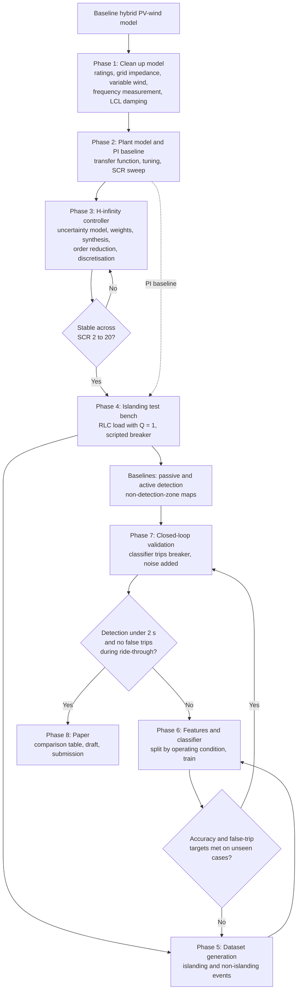

# hybrid-pv-wind-islanding-detection

Ride-through-compatible islanding detection for a grid-connected hybrid solar PV–wind system, using a machine-learning classifier on top of an H-infinity current controller. MATLAB/Simulink.

> **Status:** work in progress. Phases 1 to 4 are done (results below); phases 5 to 8 are planned and have no results yet.

## Problem

IEEE 1547-2018 asks an inverter-based source to do two things that pull against each other:

- stay connected through voltage sags and frequency swings (ride-through), and
- detect a real island and stop energising it within 2 seconds.

Passive detection (voltage, frequency, rate of change of frequency) has a non-detection zone when local load and generation are nearly matched, and it false-trips on ordinary disturbances. Active methods shrink that zone but inject disturbances and degrade power quality. Both problems get worse on a weak grid.

## Proposed approach

1. An **H-infinity current controller** keeps the inverter stable and well-damped across a range of grid strengths, so the test bed behaves properly on a weak grid.
2. A **machine-learning classifier** separates islanding from non-islanding disturbances using features measured at the point of common coupling.
3. Both are compared against PI control and against passive and active detection on the same test cases.

## System under study

| Item | Value |
|---|---|
| PV | Array with boost converter and P&O MPPT |
| Wind | PMSG with rectifier and boost converter |
| DC link | 800 V |
| Inverter | Three-phase two-level VSI, 10 kHz switching |
| Filter | LCL |
| Grid | 400 V, 50 Hz |

Ratings will be fixed and documented in phase 1 (the current model and the thesis disagree on the PV rating).

## Model

`hybrid_pv_wind_islanding.slx` is the corrected test bed (PI control and a passive detector; the H-infinity controller and ML detector come in later phases).


| Subsystem | Diagram |
|---|---|
| Wind turbine, PMSG, rectifier, boost and optimal-torque MPPT | [wind_subsystem.png](docs/wind_subsystem.png) |
| PV boost converter with perturb-and-observe MPPT | [pv_boost_mppt.png](docs/pv_boost_mppt.png) |
| Inverter control: PLL, DC-link and current loops | [inverter_control.png](docs/inverter_control.png) |
| Passive protection: voltage, frequency and rate of change of frequency | [passive_protection.png](docs/passive_protection.png) |

Regenerate the pictures with `export_diagrams` after any model change.

## Results so far

All figures below come from `hybrid_pv_wind_islanding.slx` with PI control and the passive detector.

### Phase 1: corrected test bed

| Quantity | Original model | Corrected model |
|---|---|---|
| Steady state | None: irradiance followed a 24-hour day squeezed into 2.4 s | Reached within 0.3 s |
| PV operating point | MPPT reference capped at 50 V for a 290 V array; voltage collapsed | 10.6 kW at about 290 V |
| Wind | Torque computed from a fixed speed; power not physical | Optimal-torque MPPT; rotor speed follows wind steps |
| Frequency signal | Climbed from 44 to 489 during the run | 50.00 Hz |
| Protection | Latched at start-up and could never open the breaker | Opens the breaker and stops both boost converters |
| DC link | 805 V, 43 V ripple | 800 V, 4 V ripple |
| Grid current THD | Not measurable (no steady state) | 1.2% |
| Simulation speed | 954 s per simulated second | 40 to 70 s per simulated second |

Exported power is 18.5 kW from about 20.4 kW of generation.

### First islanding check (4.4% reactive mismatch)


The fast passive detector trips 10.6 ms after the grid breaker opens. **Correction:** this case was first reported as a matched load, but the load was sized with Q_L = Q_C and ignored the inverter's own 813 var output, so it is really a 4.4% reactive mismatch. A properly matched island is not detected by either passive setting; see Phase 4.

### Phase 2: PI baseline against grid strength


Current-loop margins from the derived plant model (`scripts/plant_model.m`):

| Case | Phase margin | Gain margin | Sensitivity peak |
|---|---|---|---|
| As simulated, no control delay, SCR 20 to 2 | 86° to 89° | unlimited | 1.0 |
| With a digital delay of 1.5 switching periods | 50° to 66° | 7.8 to 8.7 dB | 1.8 to 1.9 |

Simulation with the local load removed:

| Short-circuit ratio | Result |
|---|---|
| 20, 10, 5 | Stable from a hard start; current THD 0.7 to 1.3%; PCC voltage up to 1.05 pu |
| 3 and 2, hard start at full power | Loses synchronism within 50 ms |
| 3 and 2, power ramped up after start | Stable at 17.8 kW; current THD 1.2 to 1.3%; voltage THD 2.9 to 3.6%; PCC voltage 1.07 to 1.08 pu |

The PI baseline is stable in steady state down to a short-circuit ratio of 2. It degrades in start-up at full power, in PCC voltage rise and in frequency ripple, so the case for the H-infinity controller (phase 3) rests on those and on the reduced margins once a control delay is included.

### Phase 3: H-infinity current controller

The current control is now sampled at the switching frequency with a one-sample computation delay, for both controllers. `P.ctrl.mode` selects the current controller in the same model (1 PI, 2 PID, 3 H-infinity, 4 fuzzy PI).

The controller is a structured H-infinity design (`scripts/design_hinf.m`): one order-4 controller tuned against five plants at once, at short-circuit ratios 20, 10, 5, 3 and 2.


| Design figure (with the control delay) | PI | H-infinity |
|---|---|---|
| Gain margin | 7.9 to 8.7 dB | 11.3 to 12.4 dB |
| Phase margin | 50° to 66° | 58° to 67° |
| Sensitivity peak | 1.76 to 1.93 | 1.40 to 1.49 |

Simulation with the local load removed (`scripts/compare_controllers.m`):

| Test | PI | H-infinity |
|---|---|---|
| Hard start, SCR 20 | Stable; current THD 1.7%, voltage THD 1.7% | Stable; 1.7%, 1.3% |
| Hard start, SCR 10 | Stable; 1.0%, 1.6% | Stable; 1.4%, 1.9% |
| Hard start, SCR 5 | Stable; 0.8%, 1.4% | Stable; 1.4%, 2.9% |
| Hard start, SCR 3 | Loses synchronism | Loses synchronism |
| Power ramp, SCR 3 | Stable; 1.3%, 2.7% | Stable; 1.2%, 2.5% |
| Power ramp, SCR 2 | Stable; 1.3%, 3.4% | Stable; 1.2%, 2.9% |
| DC-link deviation after the power step | 17.8 V | 17.7 V |

The H-infinity controller has better stability margins, but it gives no practical advantage in these tests. The synthesis converged close to a lower-gain PI, which trades low-frequency disturbance rejection for robustness: distortion is slightly lower at short-circuit ratios 3 and 2 and higher at 10 and 5. Neither controller survives a hard start at a ratio of 3, which points to the PLL and not the current loop. PI therefore stays the default controller for the islanding study.

### Four current controllers compared: PI, PID, H-infinity, fuzzy PI

All four sit in the same block, "Current controller d" and "Current controller q", fed by the same error and followed by the same one-sample computation delay. `P.ctrl.mode` picks one.

| Controller | Design | Script |
|---|---|---|
| PI | Baseline gains Kp = 6, Ki = 1000 | `params.m` |
| PID | Baseline PI plus a filtered derivative, Kd = 1.26e-4, filter 100 us | `design_pid.m` |
| H-infinity | Structured synthesis on five grid strengths, order 4 | `design_hinf.m` |
| Fuzzy PI | Incremental fuzzy PI, 7 sets per input, 49 rules, scaled to equal the PI for small signals | `design_flc.m` |

`pidtune` never adds derivative action on this plant: with the 1.5-sample loop delay, every increase in derivative gain raises the worst-case sensitivity peak, and Kd = 2e-3 is unstable. The PID therefore uses the largest derivative that costs no more than 5% of the PI's robustness.

Stability margins on the discrete plant with the control delay (`margins_all.m`; the fuzzy PI by its small-signal equivalent):

| Controller | Gain margin | Phase margin | Sensitivity peak |
|---|---|---|---|
| PI | 7.5 to 8.4 dB | 50° to 66° | 1.78 to 1.96 |
| PID | 6.9 to 7.8 dB | 51° to 69° | 1.82 to 2.04 |
| H-infinity | 10.7 to 11.9 dB | 58° to 68° | 1.41 to 1.51 |
| Fuzzy PI | 9.8 to 10.7 dB | 59° to 70° | 1.53 to 1.63 |


Simulation (`compare_controllers.m`, local load removed, protection unarmed). Each cell is current THD / voltage THD:

| Test | PI | PID | H-infinity | Fuzzy PI |
|---|---|---|---|---|
| Hard start, SCR 20 | 1.7% / 1.7% | 1.7% / 1.7% | 1.7% / 1.3% | 1.4% / 1.8% |
| Hard start, SCR 10 | 1.0% / 1.6% | 1.0% / 1.7% | 1.4% / 1.9% | 1.0% / 1.7% |
| Hard start, SCR 5 | 0.8% / 1.4% | 0.9% / 1.7% | 1.4% / 3.0% | 0.9% / 2.0% |
| Hard start, SCR 3 | loses synchronism | loses synchronism | loses synchronism | loses synchronism |
| Power ramp, SCR 3 | 1.3% / 2.7% | 1.3% / 3.0% | 1.2% / 2.5% | **0.8% / 1.9%** |
| Power ramp, SCR 2 | 1.3% / 3.4% | 1.0% / 2.5% | 1.2% / 2.9% | **0.7% / 1.9%** |
| Irradiance step, SCR 5 | 1.7% / 2.4% | 1.0% / 1.5% | 1.4% / 1.8% | 1.0% / 1.8% |
| DC-link dip after the irradiance step | 12.9 V | 13.5 V | 13.4 V | 13.4 V |
| DC-link settling (within 2 V) | 142 ms | 142 ms | 195 ms | **135 ms** |


Reading the results:

- **Fuzzy PI is the best all-round performer.** It has the lowest distortion on the weak grids (current THD 0.7 to 0.8% against 1.0 to 1.3%, voltage THD 1.9% against 2.5 to 3.4%), the fastest DC-link recovery, and the second-best margins.
- **H-infinity is the most robust on paper** but gives the highest distortion at SCR 5 and 10 and the slowest DC-link recovery.
- **PID behaves like PI**, as the margin analysis predicts; the derivative term can only be small on this plant.
- **No controller survives a hard start at SCR 3.** The failure is in synchronisation (PLL), not the current loop.
- **Distortion figures come from single runs** and vary by a few tenths of a percent with the MPPT's perturbation, so differences below about 0.3% should not be read as significant.

### Phase 4: islanding test bench and baseline detectors

Three baseline detectors, all evaluated offline on the same logged PCC voltage and frequency (`detect_islanding.m`):

| Detector | Settings |
|---|---|
| Fast passive | Instantaneous trip: under 0.88 pu, over 1.10 pu, under 49.3 Hz, over 50.5 Hz, rate of change of frequency over 2 Hz/s |
| IEEE passive | IEEE 1547-2018 Category II default trip settings, frequencies scaled to 50 Hz: UV 0.70 pu / 10 s and 0.45 pu / 0.16 s; OV 1.10 pu / 2 s and 1.20 pu / 0.16 s; UF 48.75 Hz / 300 s and 47.08 Hz / 0.16 s; OF 51.0 Hz / 300 s and 51.67 Hz / 0.16 s |
| IEEE + AFD | The IEEE settings with active frequency drift: q-axis current reference = bias + K·(f − 50 Hz), K = −4.1 A/Hz, bias −0.41 A, limit ±12.2 A |

The sign of the drift gain matters: with K > 0 a matched island holds at 49.95 Hz and is never detected; with K < 0 its frequency runs away (`afd_sign_test.m`).


A matched island (no active or reactive mismatch) stays at 50.05 Hz and 1.0 pu, so no passive setting can see it. With frequency drift the inverter injects reactive current as soon as the frequency moves, the frequency runs to 58.4 Hz, and the IEEE OF2 element (51.67 Hz, 0.16 s) trips 191 ms after islanding. The voltage ripple with drift is partly a measurement effect: the RMS window is fixed at 50 Hz while the island runs at 58 Hz.

**Non-detection zones.** The grid breaker opens at 0.4 s with an RLC load (Q_f = 1) sized relative to the inverter's measured output (18.57 kW, 813 var), and each detector gets the 2 s IEEE 1547-2018 allows (`ndz_sweep.m`, `island_case.m`, 70 runs):


**False trips.** Eleven ordinary disturbances with the grid connected; every trip is false (`false_trip_test.m`). The grid events use a programmable source; the load and capacitor are switched in at the PCC.


Why a threshold cannot work: the rate of change of frequency the relay sees after an island (peak 16 Hz/s) is no different in kind from what an irradiance step (4 Hz/s), a capacitor switching (10 Hz/s), a voltage sag (17 Hz/s) or a phase jump (106 Hz/s) produces. Any threshold low enough to catch the island also trips on these events.

| Event | Fast passive | IEEE passive | IEEE + AFD |
|---|---|---|---|
| Irradiance 1000 to 600 W/m² | trips (12 ms) | no trip | no trip |
| Irradiance 600 to 1000 W/m² | trips (13 ms) | no trip | no trip |
| Wind 12 to 9 m/s | no trip | no trip | no trip |
| Load switched on (+6 kW) | trips (6 ms) | no trip | no trip |
| Capacitor switched on (5 kvar) | trips (4 ms) | no trip | no trip |
| Voltage sag to 0.7 pu, 0.5 s | trips (3 ms) | no trip | no trip |
| Voltage sag to 0.5 pu, 0.2 s | trips (3 ms) | no trip | no trip |
| Voltage swell to 1.15 pu, 0.5 s | trips (4 ms) | no trip | no trip |
| Frequency ramp −2 Hz/s for 0.5 s | trips (51 ms) | no trip | no trip |
| Frequency ramp +2 Hz/s for 0.5 s | trips (76 ms) | no trip | no trip |
| Phase jump 20° | trips (2 ms) | no trip | no trip |

| Detector | Islands detected (35) | Detection time | False trips (11) |
|---|---|---|---|
| Fast passive | 34 | 7 to 52 ms | 10 |
| IEEE passive | 0 | none within 2 s | 0 |
| IEEE + AFD | 35 | 160 to 275 ms | 0 |


Reading the results:

- **The trade-off the paper rests on is real.** Settings fast enough to catch islands trip on almost every ordinary disturbance; ride-through-compliant settings trip on nothing, including real islands.
- **Active frequency drift solves both in this test bed**, at SCR 10 with Q_f = 1: every island detected in under 0.3 s and no false trips. Its cost is small here: grid-connected current THD 2.08% with and without it, and about 100 var of extra reactive exchange.
- **So the case for an ML detector is not made yet.** It has to come from conditions where active drift is known to struggle, which Phase 5 must include: weak grids (SCR 2 to 3), higher quality-factor loads (Q_f = 2.5), several inverters whose drift can cancel, and its slower detection (160 to 275 ms against tens of ms for a passive method).

### Known limitations

- PI and PLL gains are a first pass, not optimised.
- PV current readings are unreliable when the PV voltage is far above its operating point, including after a trip.
- Generator stator inductance (3 mH) and rotor inertia (10 kg m²) were changed from the original so the machine can deliver 10 kW through a diode rectifier.

## Workflow



### Phase 1 — Clean up the baseline model
- Fix one rating for PV and wind and use it everywhere.
- Replace the near-ideal grid source with a realistic impedance, parameterised by short-circuit ratio (SCR).
- Add a variable wind-speed profile and wind-side MPPT to the hybrid model.
- Correct the frequency measurement (take it from the PLL; the gain must be `1/(2*pi)`).
- Redesign the LCL damping resistor to match the design equation.
- Output: one parameter script, `scripts/params.m`, that every model reads.

### Phase 2 — Plant model and PI baseline
- Derive the transfer function of inverter + LCL filter + grid impedance.
- Tune the PI current controller properly and record its margins.
- Sweep SCR (20, 10, 5, 3, 2) and record where PI degrades.
- Output: Bode plots, stability limits, baseline distortion and DC-link response.

### Phase 3 — H-infinity controller
- Model grid inductance as an uncertain parameter over the SCR range.
- Choose weighting functions for tracking, control effort and robustness, and document the reasoning.
- Synthesise with the Robust Control Toolbox (`mixsyn` or `ncfsyn`; `musyn` for structured uncertainty).
- Reduce the controller order and discretise at the switching rate.
- Output: PI vs H-infinity on the same SCR sweep — stability margins, settling time, overshoot, current distortion.

### Phase 4 — Islanding test bench
- Add a parallel RLC load at the point of common coupling, tuned to 50 Hz with quality factor 1 (IEEE 1547.1 unintentional-islanding test).
- Script the grid breaker to open during the run.
- Implement two baselines: passive (over/under voltage, over/under frequency, rate of change of frequency) and one active method (frequency shift or reactive-power perturbation).
- Sweep active and reactive power mismatch and map the non-detection zone of each baseline.
- Output: non-detection-zone maps and detection times for the baselines.

### Phase 5 — Dataset generation
- Islanding cases: the mismatch sweep, at several PV/wind power shares and SCR values.
- Non-islanding cases: sags, swells, faults, load switching, capacitor switching, irradiance steps, wind steps, frequency excursions.
- Automate with a batch script (`parsim`), logging voltage and current at the point of common coupling with a label and event time.
- Output: labelled raw signals in `data/raw/`.

### Phase 6 — Features and classifier
- Extract features over a short sliding window: voltage magnitude, frequency, rate of change of frequency, phase jump, rate of change of power, current and voltage distortion, negative-sequence voltage.
- Split by operating condition, not by random sample, so the test set contains unseen conditions.
- Train a random forest and an SVM first, then a small neural network; keep the simplest model that meets the targets.
- Output: trained model, confusion matrix, feature importance.

### Phase 7 — Closed-loop validation
- Put the trained classifier back into Simulink so it trips the breaker itself.
- Re-run the full test set with measurement noise added.
- Report, for the proposed method and both baselines:
  - detection time against the 2-second limit,
  - non-detection zone,
  - false-trip rate during ride-through events,
  - effect on current distortion.
- Repeat with PI and with H-infinity control to show what the controller contributes.

### Phase 8 — Paper
- Comparison table against recent published methods.
- Draft, internal review by supervisors, submission.

## Repository layout

```
hybrid_pv_wind_islanding.slx   Corrected test-bed model (R2024b), built by scripts/build_model.m
MATLAB_R2018a/                 Original Simulink models, saved in R2018a (kept unchanged)
scripts/params.m               Every rating, gain and test setting in one place
scripts/build_model.m          Rebuilds the corrected model from the original, change by change
scripts/run_model.m            Runs the model and reports power, DC link, frequency, distortion, trip
scripts/run_baseline.m         Runs the original model for the before/after comparison
scripts/export_diagrams.m      Saves the model diagrams to docs/
scripts/plant_model.m          Current-loop plant: inverter, LCL filter, grid and voltage feedforward
scripts/loop_margins.m         Stability margins of the current loop
scripts/analyze_pi.m           Margins of the PI baseline at each grid strength
scripts/sweep_scr.m            Simulates the PI baseline at each grid strength
scripts/softstart_scr.m        Weak-grid test with power ramped up after start
scripts/signal_metrics.m       Power, distortion, DC-link and frequency figures from a run
scripts/plot_pi_bode.m         Draws docs/pi_loop_bode.png
scripts/plot_islanding.m       Draws docs/islanding_matched.png
scripts/design_hinf.m          Structured H-infinity current controller design
scripts/hinf_controller.mat    The designed controller, read by params.m
scripts/compare_controllers.m  All four current controllers on the same test suite
scripts/plot_controller_sensitivity.m  Draws docs/controller_sensitivity.png
scripts/design_pid.m           PID current controller (baseline PI plus filtered derivative)
scripts/design_flc.m           Fuzzy PI current controller
scripts/discrete_plant.m       Current-loop plant as the digital controller sees it
scripts/margins_all.m          Margins of all four controllers at each grid strength
scripts/plot_controller_comparison.m  Draws docs/controllers_sensitivity.png and docs/controllers_step.png
scripts/demo_hinf.m            Walk-through of the H-infinity controller for a demonstration
scripts/detect_islanding.m     Replays logged voltage and frequency through a set of relay settings
scripts/island_case.m          Sizes the RLC load for a given active/reactive mismatch
scripts/afd_sign_test.m        Matched island with no drift and with drift of each sign
scripts/ndz_sweep.m            Non-detection-zone sweep (70 runs); evaluate_ndz.m scores it
scripts/false_trip_test.m      Eleven non-islanding disturbances through every detector
scripts/plot_ndz.m            Draws docs/ndz_maps.png
scripts/plot_phase4.m          Draws the island, ROCOF and detector-summary figures
scripts/disturbance_events.m   The eleven ordinary disturbances used for false-trip tests
scripts/relay_signals.m        Voltage, frequency and ROCOF as a relay sees them
docs/                          Model diagrams and result figures
results/                       Simulation outputs, not tracked in git
data/, ml/, paper/             Planned
report/, archive/              Kept locally, not tracked
```

To run an islanding case:

```matlab
addpath scripts
P = params(10);            % short-circuit ratio 10
P.tIsland = 0.5;           % open the grid breaker at 0.5 s
P.load.P = 18.4e3; P.load.QL = P.load.P; P.load.QC = P.load.P;   % matched RLC load, Qf = 1
run_model(1.0, P, 'island_matched');
```

## Requirements

- MATLAB with Simulink and Simscape Electrical (Specialized Power Systems)
- Robust Control Toolbox
- Statistics and Machine Learning Toolbox
- Parallel Computing Toolbox (optional, for batch runs)

## Authors

To be confirmed with the project team and supervisors.
