# hybrid-pv-wind-islanding-detection

Ride-through-compatible islanding detection for a grid-connected hybrid solar PV–wind system. A small neural network, running inside the inverter's own controls, tells a real island from the ordinary disturbances an inverter must ride through. It is tested in closed loop with sensor noise, on grid conditions it never saw, under four current controllers (PI, PID, H-infinity, fuzzy PI), and on a real 400 V distribution feeder in Nepal. MATLAB/Simulink.

## Where the project stands

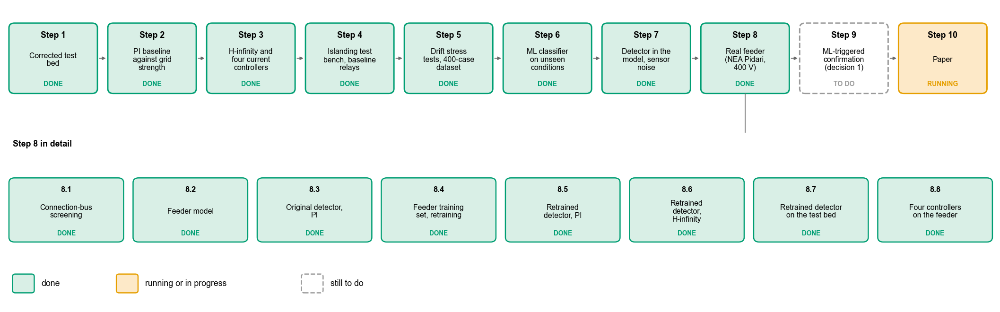

| Step | What | Status |
|---|---|---|
| 1 | Corrected test bed | ✅ Done |
| 2 | PI baseline against grid strength | ✅ Done |
| 3 | H-infinity and four current controllers compared | ✅ Done |
| 4 | Islanding test bench and baseline relays | ✅ Done |
| 5 | Frequency-drift stress tests and the 400-case dataset | ✅ Done |
| 6 | ML classifier tested on unseen conditions | ✅ Done |
| 7 | Detector inside the model, with sensor noise, in closed loop | ✅ Done |
| 8 | Real feeder: NEA Pidari, 400 V feeder of the Khajuri Chanha transformer | ✅ Done |
| 8.1 | Connection-bus screening | ✅ Done |
| 8.2 | Feeder model | ✅ Done |
| 8.3 | Original detector on the feeder, PI | ✅ Done |
| 8.4 | Feeder training set and retraining | ✅ Done |
| 8.5 | Retrained detector on the feeder, PI | ✅ Done |
| 8.6 | Retrained detector on the feeder, H-infinity | ✅ Done |
| 8.7 | Retrained detector back on the test bed, PI and H-infinity | ✅ Done |
| 8.8 | Four current controllers on the feeder | ✅ Done |
| 9 | ML-triggered confirmation, to remove the load-switching false trips (decision 1) | ✅ Done |
| 10 | Paper | ⏳ Draft written; feeder results and step 9 still to go in (next) |

In the scripts, steps 1 to 7 are called Phase 1 to Phase 7 (for example `run_phase7.m`).

## Decisions

| No. | Date | Question | Decision |
|---|---|---|---|
| 1 | 2026-10-19 | On the real feeder the detector, retrained or not, still trips on load switching close to the unit (8 of 39 ordinary events). How to deal with it? Options were (1) an ML-triggered confirmation, (2) a longer confirmation delay, (3) report it as a limitation. | **Option 1: ML-triggered confirmation** (step 9). When the network raises an alarm, the inverter applies a short reactive-power nudge and trips only if the PCC responds as an island does. Outcome (2026-10-23): 0 of 39 feeder events tripped under PI and under H-infinity, every island still detected, 30 ms added. |

## Problem

IEEE 1547-2018 asks an inverter-based source to do two things that pull against each other:

- stay connected through voltage sags and frequency swings (ride-through), and
- detect a real island and stop energising it within 2 seconds.

Passive detection (voltage, frequency, rate of change of frequency) has a non-detection zone when local load and generation are nearly matched, and it false-trips on ordinary disturbances. Active methods shrink that zone but inject disturbances, can be cancelled by a neighbouring inverter, and can destabilise a weak grid.

## Approach

1. A corrected and fully parameterised hybrid PV–wind test bed with four current controllers (PI, PID, structured H-infinity, fuzzy PI).
2. A **machine-learning detector** that uses only what the inverter already measures, trained and tested by operating condition (never by random split), then run inside the switching model with sensor noise, tripping the inverter itself.
3. Comparison on the same cases with a fast passive relay, the IEEE 1547-2018 relay, and active frequency drift (AFD).
4. Validation on a real low-voltage feeder in Nepal: the detector unchanged, then retrained, then (step 9) with a confirmation stage.

## System under study

| Item | Value |
|---|---|
| PV | 10.7 kW at STC (10 series × 5 parallel modules), boost converter, perturb-and-observe MPPT |
| Wind | PMSG, 10 kW at 12 m/s, diode rectifier, boost converter, optimal-torque MPPT |
| DC link | 800 V, 3.2 mF |
| Inverter | Three-phase two-level VSI, 20 kVA, 10 kHz switching |
| Filter | LCL: 1.6 mH, 15 µF, 0.8 mH |
| Grid (test bed) | 400 V, 50 Hz, programmable source behind an impedance set by the short-circuit ratio (SCR), X/R 3 |
| Grid (real feeder) | NEA Pidari 11 kV feeder, 100 kVA 11/0.433 kV transformer, 400 V overhead ABC feeder (X/R 0.43 to 1.8) |


The PV–wind unit, its inverter and control, the local RLC load and a second inverter all sit at the point of common coupling (PCC). CB1 is the unit's own breaker, opened by the protection; CB2 islands the PCC from the grid. The ML detector (bottom row) takes the inverter's own measurements, computes 22 change features every 5 ms over a 20 ms window, scores them with a 22–20–10–2 network and opens CB1 after 4 windows in a row score above 0.8.

## Model pictures

`hybrid_pv_wind_islanding.slx` is the test bed, built by `scripts/build_model.m` from the original model in `MATLAB_R2018a/`. `hybrid_pv_wind_feeder.slx` is the same unit connected to the real feeder, built by `scripts/build_feeder_model.m`. Regenerate the Simulink pictures with `export_diagrams` after any model change.

**Top level of the test bed**

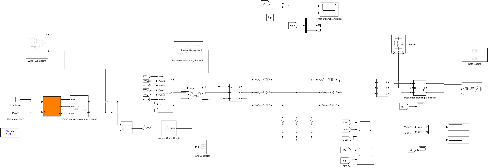

**PV, wind and inverter control as block diagrams**: (a) PV chain with perturb-and-observe on the boost duty cycle; (b) wind chain, where the boost current reference follows the optimal-torque curve; (c) grid inverter control: SRF-PLL, DC-link PI, the selectable current controller with decoupling and feed-forward, and the relays or ML detector that act on the trip latch.


**What the PV and wind models produce**: (a, b) the array's current and power against voltage at 200 to 1000 W/m², with the maximum power points the MPPT tracks; (c) the turbine's power coefficient against tip-speed ratio (peak 0.411 at 7.95); (d) turbine power against rotor speed at 6 to 12 m/s, with the optimal-torque curve the MPPT follows.


**Wind turbine, PMSG, rectifier, boost and optimal-torque MPPT** (Simulink)

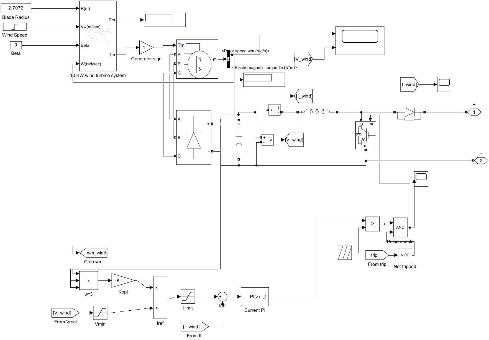

**PV boost converter with perturb-and-observe MPPT** (Simulink)

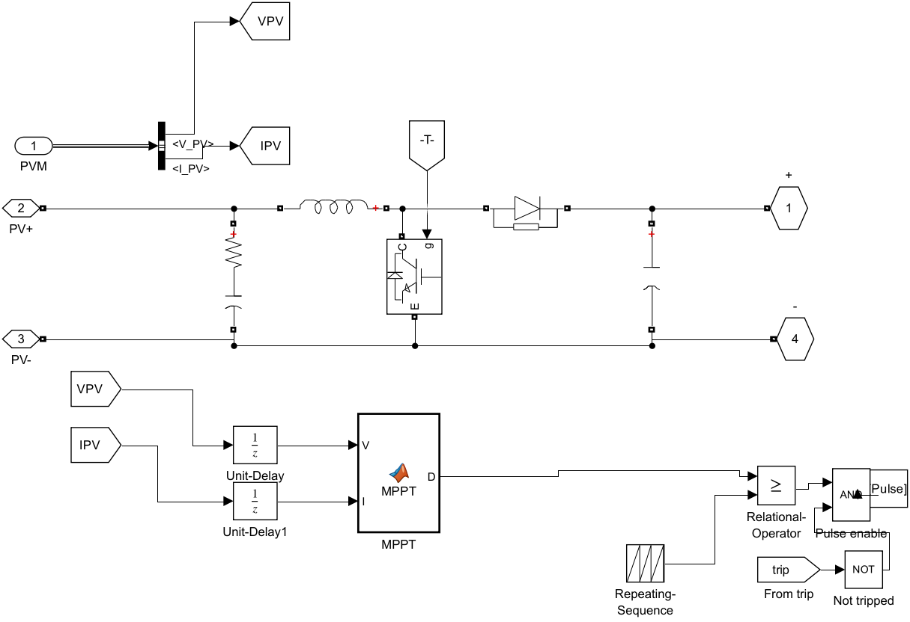

**Inverter control: PLL, DC-link and current loops** (Simulink)

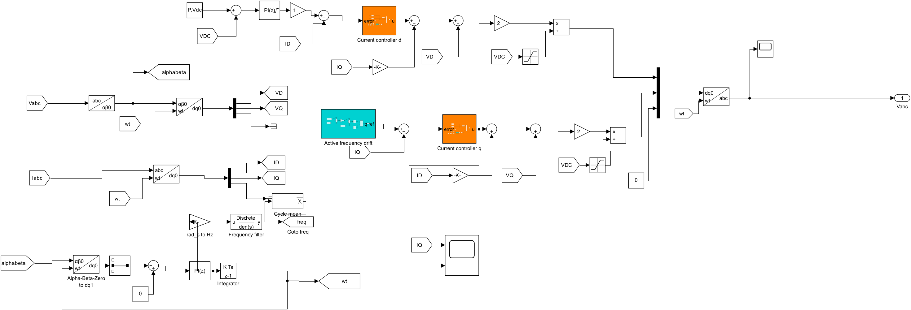

**Current controller block**: one block holds all four controllers, fed by the same error and followed by the same one-sample computation delay; `P.ctrl.mode` picks PI (1), PID (2), H-infinity (3) or fuzzy PI (4).

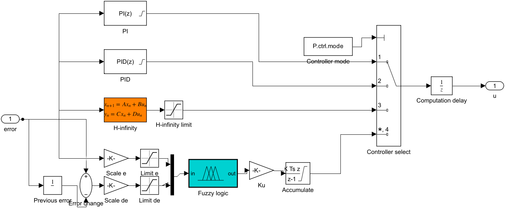

**Passive protection: voltage, frequency and rate of change of frequency** (Simulink)

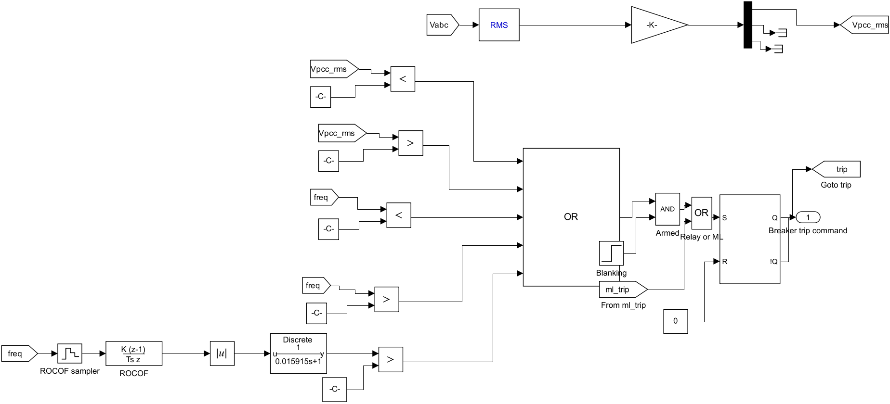

**Second inverter**: constant-power current references from the PCC voltage, with optional reactive drift against frequency (used for the multi-inverter cases).

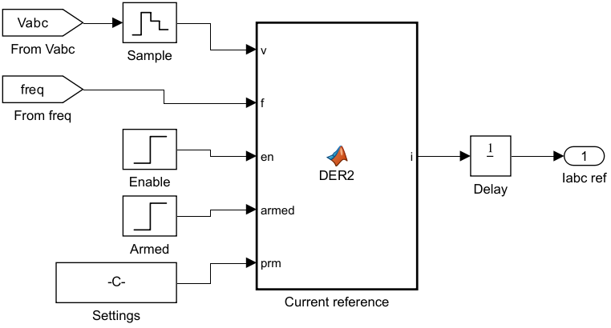

**Sensor noise**: white noise added to every measured voltage, current and DC-link voltage before the controls and detectors see it.

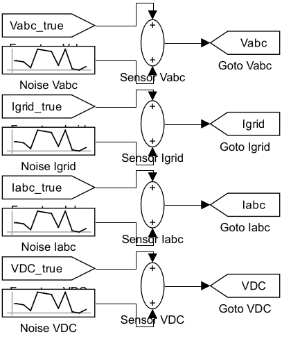

**The ML detector block**: buffers the inverter's measurements, computes the features with the same code as offline (`ml_features.m`), runs the network and drives the trip. Since step 9 it also holds the confirmation: the `Confirmation` settings (`P.ml.confirm`) switch it on, and on an alarm the block sends a reactive-current nudge (`ml_nudge`, added to the q-axis reference in the inverter control) and reports the PCC voltage angle's response (`ml_resp`, `ml_raw`) before it decides. With the confirmation off it behaves exactly as before (checked by `confirm_check.m`).

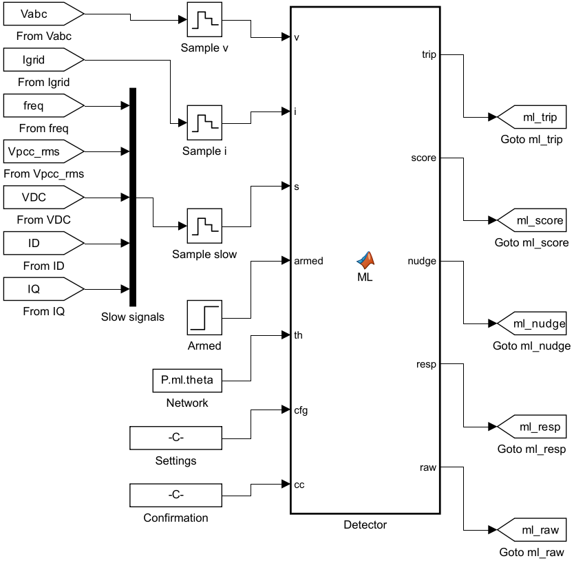

**The real feeder**: (a) the Pidari 11 kV feeder, coloured by voltage at the recorded peak, with the Khajuri Chanha transformer at its far end (0.81 pu at peak); (b) the 400 V feeder of that transformer as modelled, with the two island points (the transformer breaker, which islands the whole feeder, and the unit's own breaker), the unit at A5 (or A3), the other generation lumped at B3 and the 10 kW switched load used for events.


**The feeder in Simulink** (`hybrid_pv_wind_feeder.slx`, the part right of the unit): at the bottom left the 11 kV programmable source, the upstream equivalent (11 kV network and the 100 kVA transformer), the transformer breaker that islands the whole feeder, and the meter at the transformer; then the A branch (lines DT–A1 to A4–A5) and the B branch (DT–B1 to B2–B3), each pole with its constant-impedance load, and the switched 10 kW load at B3. The row of "Service to …" branches places the PV–wind unit: the branch to the chosen bus is 1 mΩ and the others 1 MΩ, so one model serves every connection bus. The "Second inverter to …" branches at the top place the other generation the same way (at B3 in all feeder tests), fed by three controlled current sources.

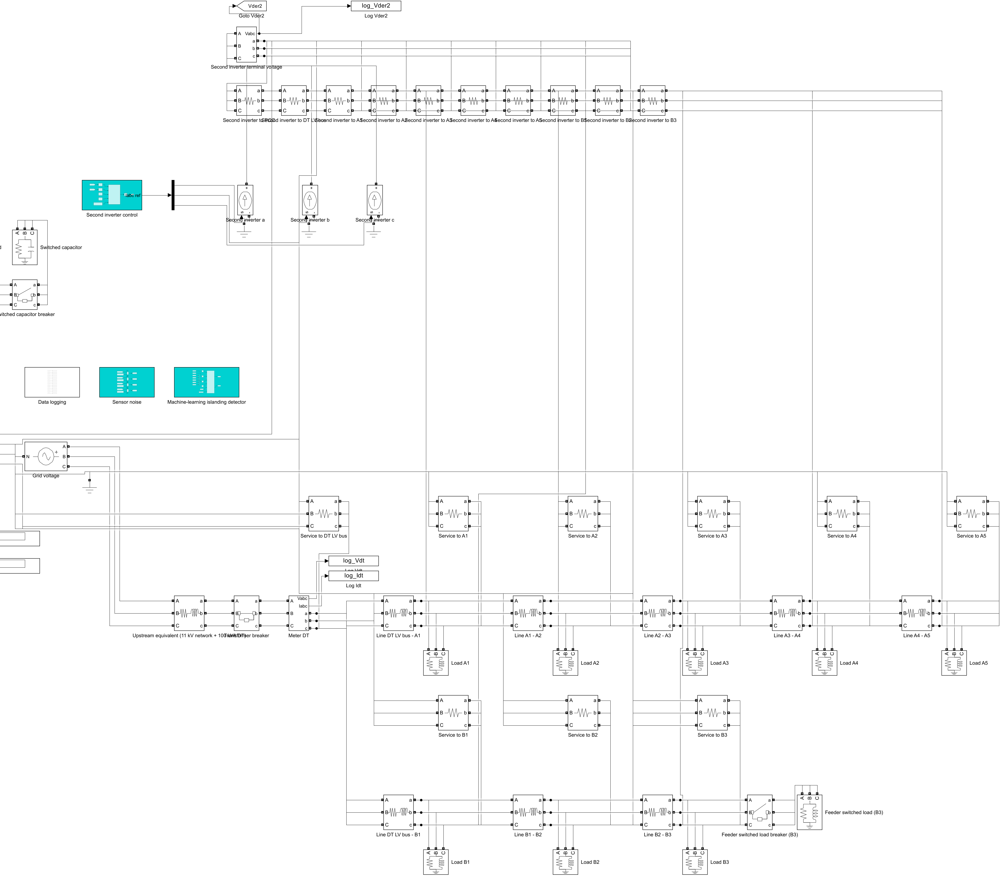

**The second inverter on the feeder**: its voltage and frequency inputs are sampled at the inverter's control rate, and the MATLAB function computes the constant-power current reference through a SOGI filter on the voltage. Without the filter, the constant-power law acts as a negative resistance at high frequency and oscillates at 17 to 20 kHz on the lightly loaded feeder.

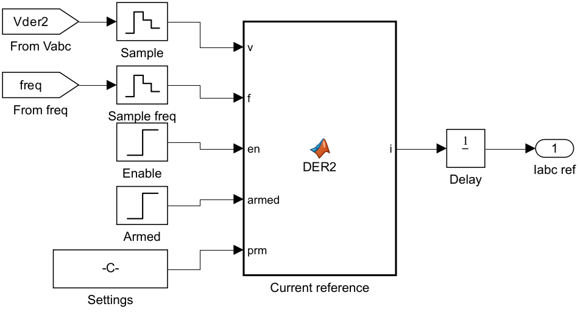

---

## Step 1: corrected test bed ✅

| Quantity | Original model | Corrected model |
|---|---|---|
| Steady state | None: irradiance followed a 24-hour day squeezed into 2.4 s | Reached within 0.3 s |
| PV operating point | MPPT reference capped at 50 V for a 290 V array; voltage collapsed | 10.6 kW at about 290 V |
| Wind | Torque computed from a fixed speed; power not physical | Optimal-torque MPPT; rotor speed follows wind steps |
| Frequency signal | Climbed from 44 to 489 during the run | 50.00 Hz |
| Protection | Latched at start-up and could never open the breaker | Opens the breaker and stops both boost converters |
| DC link | 805 V, 43 V ripple | 800 V, 4 V ripple |
| Grid current THD | Not measurable (no steady state) | 1.2% |
| Simulation speed | 954 s per simulated second | 40 to 70 s per simulated second |

Exported power is 18.5 kW from about 20.4 kW of generation.

**First islanding check (4.4% reactive mismatch)**

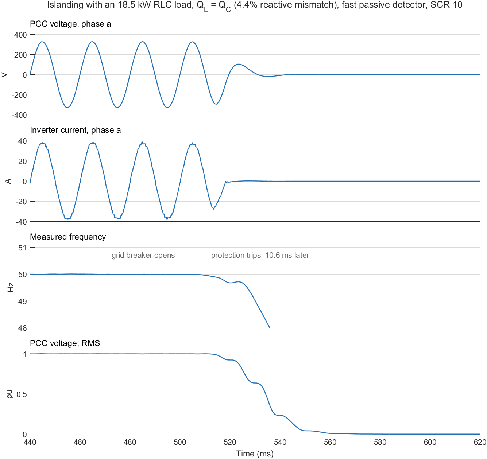

The fast passive detector trips 10.6 ms after the grid breaker opens. **Correction:** this case was first reported as a matched load, but the load was sized with Q_L = Q_C and ignored the inverter's own 813 var output, so it is really a 4.4% reactive mismatch. A properly matched island is not detected by either passive setting; see step 4.

## Step 2: PI baseline against grid strength ✅

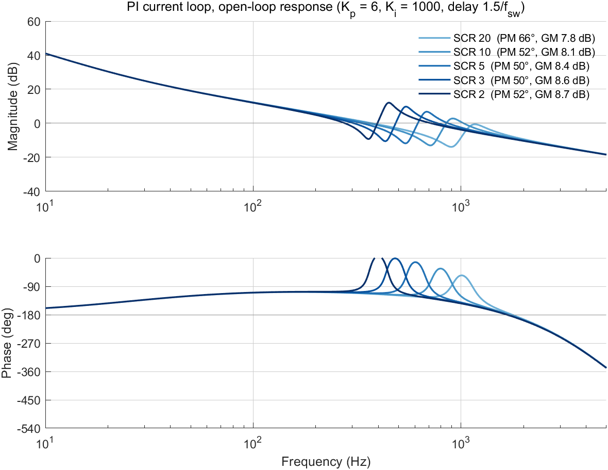

The Bode plot is the PI current loop's open-loop response at each grid strength; the margins below are read from it.

Current-loop margins from the derived plant model (`scripts/plant_model.m`):

| Case | Phase margin | Gain margin | Sensitivity peak |
|---|---|---|---|
| As simulated, no control delay, SCR 20 to 2 | 86° to 89° | unlimited | 1.0 |
| With a digital delay of 1.5 switching periods | 50° to 66° | 7.8 to 8.7 dB | 1.8 to 1.9 |

Simulation with the local load removed:

| Short-circuit ratio | Result |
|---|---|
| 20, 10, 5 | Stable from a hard start; current THD 0.7 to 1.3%; PCC voltage up to 1.05 pu |
| 3 and 2, hard start at full power | Loses synchronism within 50 ms |
| 3 and 2, power ramped up after start | Stable at 17.8 kW; current THD 1.2 to 1.3%; voltage THD 2.9 to 3.6%; PCC voltage 1.07 to 1.08 pu |

The PI baseline is stable in steady state down to a short-circuit ratio of 2. It degrades in start-up at full power, in PCC voltage rise and in frequency ripple.

## Step 3: H-infinity and four current controllers ✅

The current control is sampled at the switching frequency with a one-sample computation delay, for every controller. `P.ctrl.mode` selects the current controller in the same model.

**H-infinity design.** A structured H-infinity design (`scripts/design_hinf.m`): one order-4 controller tuned against five plants at once, at short-circuit ratios 20, 10, 5, 3 and 2.

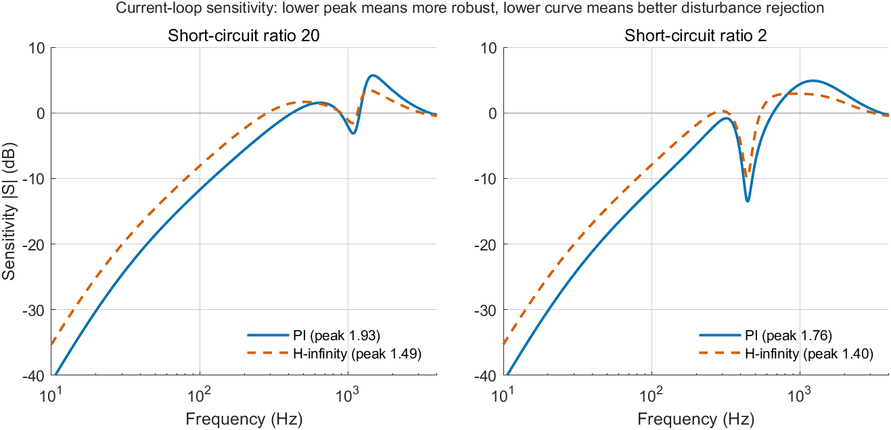

The sensitivity plot shows how much a disturbance is amplified at each frequency: the lower the peak, the more robust the loop. H-infinity lowers the peak from about 1.9 to about 1.45 at every grid strength.

| Design figure (with the control delay) | PI | H-infinity |
|---|---|---|
| Gain margin | 7.9 to 8.7 dB | 11.3 to 12.4 dB |
| Phase margin | 50° to 66° | 58° to 67° |
| Sensitivity peak | 1.76 to 1.93 | 1.40 to 1.49 |

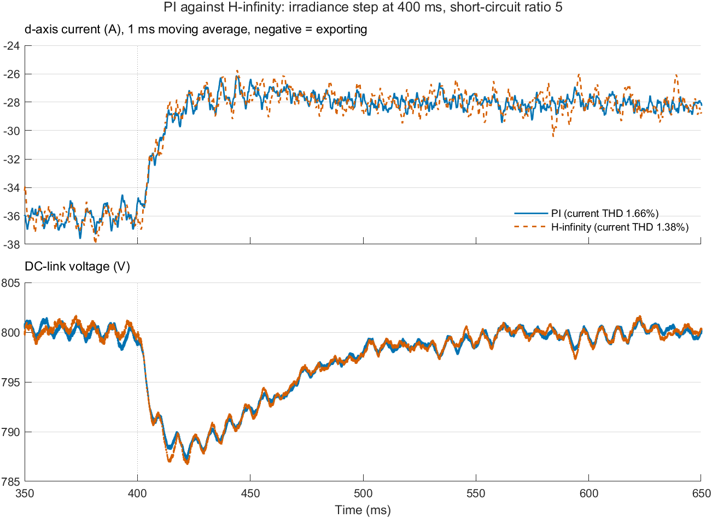

An irradiance step at 400 ms on a short-circuit ratio of 5 (`demo_hinf.m`): the d-axis current and the DC-link voltage follow almost the same path under both controllers. The extra robustness does not show up as a visibly different response.

**Four controllers compared.** All four sit in the same block (see the current controller picture above).

| Controller | Design | Script |
|---|---|---|
| PI | Baseline gains Kp = 6, Ki = 1000 | `params.m` |
| PID | Baseline PI plus a filtered derivative, Kd = 1.26e-4, filter 100 us | `design_pid.m` |
| H-infinity | Structured synthesis on five grid strengths, order 4 | `design_hinf.m` |
| Fuzzy PI | Incremental fuzzy PI, 7 sets per input, 49 rules, scaled to equal the PI for small signals | `design_flc.m` |

`pidtune` never adds derivative action on this plant: with the 1.5-sample loop delay, every increase in derivative gain raises the worst-case sensitivity peak, and Kd = 2e-3 is unstable. The PID therefore uses the largest derivative that costs no more than 5% of the PI's robustness.

Stability margins on the discrete plant with the control delay (`margins_all.m`; the fuzzy PI by its small-signal equivalent):

| Controller | Gain margin | Phase margin | Sensitivity peak |
|---|---|---|---|
| PI | 7.5 to 8.4 dB | 50° to 66° | 1.78 to 1.96 |
| PID | 6.9 to 7.8 dB | 51° to 69° | 1.82 to 2.04 |
| H-infinity | 10.7 to 11.9 dB | 58° to 68° | 1.41 to 1.51 |
| Fuzzy PI | 9.8 to 10.7 dB | 59° to 70° | 1.53 to 1.63 |

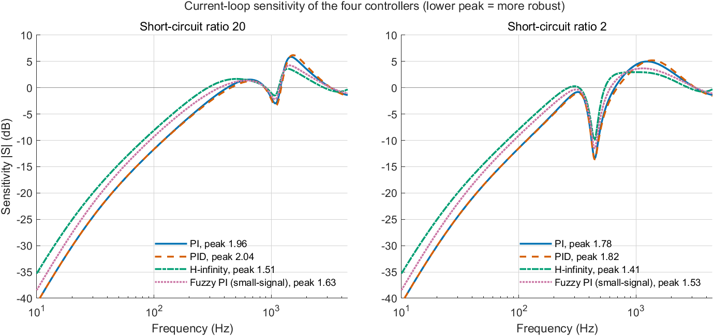

Simulation (`compare_controllers.m`, local load removed, protection unarmed). Each cell is current THD / voltage THD:

| Test | PI | PID | H-infinity | Fuzzy PI |
|---|---|---|---|---|
| Hard start, SCR 20 | 1.7% / 1.7% | 1.7% / 1.7% | 1.7% / 1.3% | 1.4% / 1.8% |
| Hard start, SCR 10 | 1.0% / 1.6% | 1.0% / 1.7% | 1.4% / 1.9% | 1.0% / 1.7% |
| Hard start, SCR 5 | 0.8% / 1.4% | 0.9% / 1.7% | 1.4% / 3.0% | 0.9% / 2.0% |
| Hard start, SCR 3 | loses synchronism | loses synchronism | loses synchronism | loses synchronism |
| Power ramp, SCR 3 | 1.3% / 2.7% | 1.3% / 3.0% | 1.2% / 2.5% | **0.8% / 1.9%** |
| Power ramp, SCR 2 | 1.3% / 3.4% | 1.0% / 2.5% | 1.2% / 2.9% | **0.7% / 1.9%** |
| Irradiance step, SCR 5 | 1.7% / 2.4% | 1.0% / 1.5% | 1.4% / 1.8% | 1.0% / 1.8% |
| DC-link dip after the irradiance step | 12.9 V | 13.5 V | 13.4 V | 13.4 V |
| DC-link settling (within 2 V) | 142 ms | 142 ms | 195 ms | **135 ms** |

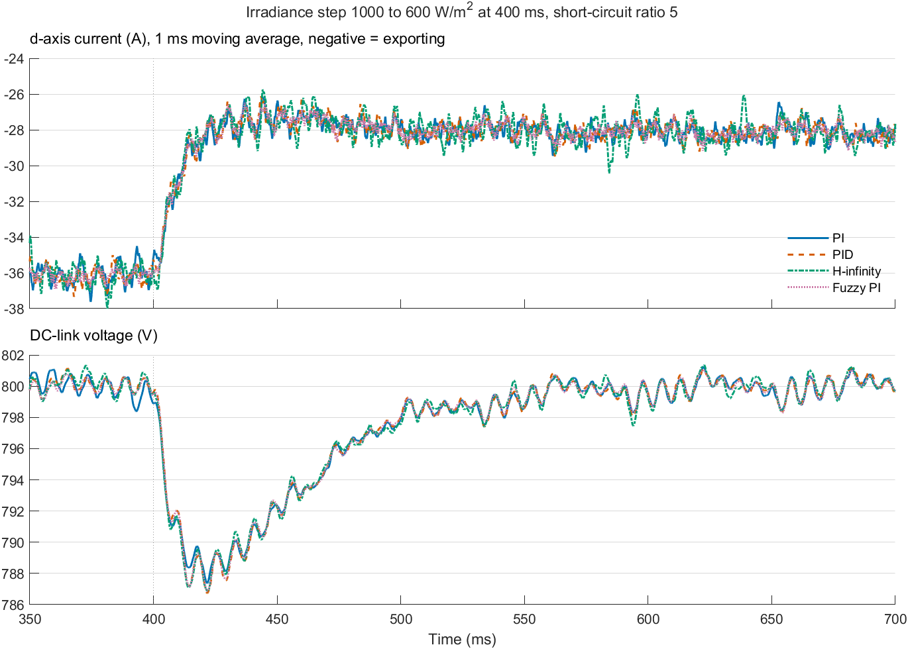

Reading the results:

- **Fuzzy PI is the best all-round performer.** It has the lowest distortion on the weak grids (current THD 0.7 to 0.8% against 1.0 to 1.3%, voltage THD 1.9% against 2.5 to 3.4%), the fastest DC-link recovery, and the second-best margins.
- **H-infinity is the most robust on paper** but gives the highest distortion at SCR 5 and 10 and the slowest DC-link recovery. The synthesis converged close to a lower-gain PI.
- **PID behaves like PI**, as the margin analysis predicts; the derivative term can only be small on this plant.
- **No controller survives a hard start at SCR 3.** The failure is in synchronisation (PLL), not the current loop.
- **Distortion figures come from single runs** and vary by a few tenths of a percent with the MPPT's perturbation, so differences below about 0.3% should not be read as significant.
- PI stays the default controller; H-infinity is repeated in every closed-loop detector test (steps 7 and 8).

## Step 4: islanding test bench and baseline relays ✅

Three baseline detectors, all evaluated offline on the same logged PCC voltage and frequency (`detect_islanding.m`):

| Detector | Settings |
|---|---|
| Fast passive | Instantaneous trip: under 0.88 pu, over 1.10 pu, under 49.3 Hz, over 50.5 Hz, rate of change of frequency over 2 Hz/s |
| IEEE passive | IEEE 1547-2018 Category II default trip settings, frequencies scaled to 50 Hz: UV 0.70 pu / 10 s and 0.45 pu / 0.16 s; OV 1.10 pu / 2 s and 1.20 pu / 0.16 s; UF 48.75 Hz / 300 s and 47.08 Hz / 0.16 s; OF 51.0 Hz / 300 s and 51.67 Hz / 0.16 s |
| IEEE + AFD | The IEEE settings with active frequency drift: q-axis current reference = bias + K·(f − 50 Hz), K = −4.1 A/Hz, bias −0.41 A, limit ±12.2 A |

The sign of the drift gain matters: with K > 0 a matched island holds at 49.95 Hz and is never detected; with K < 0 its frequency runs away (`afd_sign_test.m`).

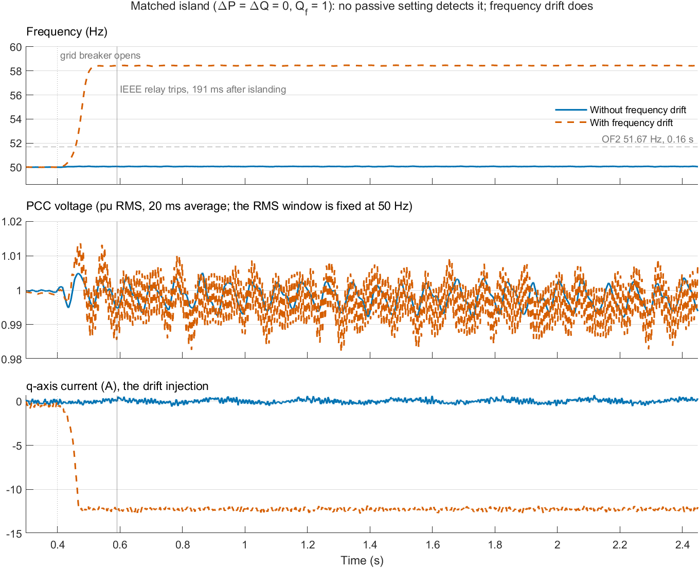

A matched island (no active or reactive mismatch) stays at 50.05 Hz and 1.0 pu, so no passive setting can see it. With frequency drift the inverter injects reactive current as soon as the frequency moves, the frequency runs to 58.4 Hz, and the IEEE OF2 element (51.67 Hz, 0.16 s) trips 191 ms after islanding. The voltage ripple with drift is partly a measurement effect: the RMS window is fixed at 50 Hz while the island runs at 58 Hz.

**Non-detection zones.** The grid breaker opens at 0.4 s with an RLC load (Q_f = 1) sized relative to the inverter's measured output (18.57 kW, 813 var), and each detector gets the 2 s IEEE 1547-2018 allows (`ndz_sweep.m`, `island_case.m`, 70 runs). Each map shows the detection time over the plane of active and reactive power mismatch; blank cells were not detected within 2 s.

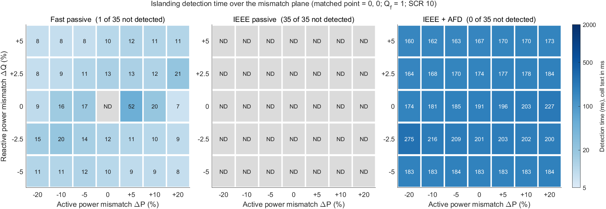

**False trips.** Eleven ordinary disturbances with the grid connected; every trip is false (`false_trip_test.m`). The grid events use a programmable source; the load and capacitor are switched in at the PCC.

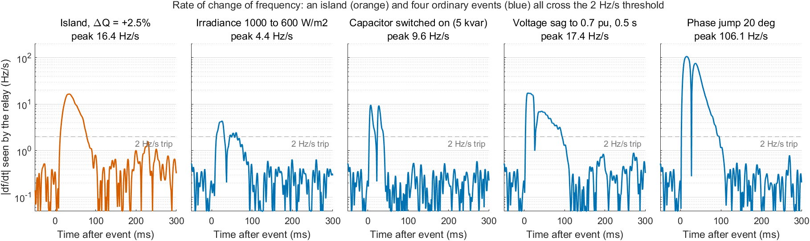

Why a threshold cannot work: the rate of change of frequency the relay sees after an island (peak 16 Hz/s) is no different in kind from what an irradiance step (4 Hz/s), a capacitor switching (10 Hz/s), a voltage sag (17 Hz/s) or a phase jump (106 Hz/s) produces. Any threshold low enough to catch the island also trips on these events.

| Event | Fast passive | IEEE passive | IEEE + AFD |
|---|---|---|---|
| Irradiance 1000 to 600 W/m² | trips (12 ms) | no trip | no trip |
| Irradiance 600 to 1000 W/m² | trips (13 ms) | no trip | no trip |
| Wind 12 to 9 m/s | no trip | no trip | no trip |
| Load switched on (+6 kW) | trips (6 ms) | no trip | no trip |
| Capacitor switched on (5 kvar) | trips (4 ms) | no trip | no trip |
| Voltage sag to 0.7 pu, 0.5 s | trips (3 ms) | no trip | no trip |
| Voltage sag to 0.5 pu, 0.2 s | trips (3 ms) | no trip | no trip |
| Voltage swell to 1.15 pu, 0.5 s | trips (4 ms) | no trip | no trip |
| Frequency ramp −2 Hz/s for 0.5 s | trips (51 ms) | no trip | no trip |
| Frequency ramp +2 Hz/s for 0.5 s | trips (76 ms) | no trip | no trip |
| Phase jump 20° | trips (2 ms) | no trip | no trip |

| Detector | Islands detected (35) | Detection time | False trips (11) |
|---|---|---|---|
| Fast passive | 34 | 7 to 52 ms | 10 |
| IEEE passive | 0 | none within 2 s | 0 |
| IEEE + AFD | 35 | 160 to 275 ms | 0 |

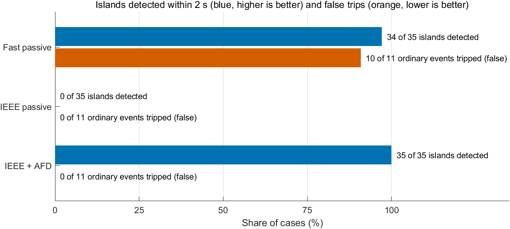

Reading the results:

- **The trade-off the paper rests on is real.** Settings fast enough to catch islands trip on almost every ordinary disturbance; ride-through-compliant settings trip on nothing, including real islands.
- **Active frequency drift solves both in this test bed**, at SCR 10 with Q_f = 1: every island detected in under 0.3 s and no false trips. So the case for an ML detector has to come from conditions where drift struggles: weak grids, higher quality-factor loads, and several inverters whose drift can cancel. Step 5 tests exactly these.

## Step 5: where active frequency drift fails, and the dataset ✅

**Stress tests of active frequency drift** (`afd_stress.m`, 23 runs, IEEE 1547-2018 settings, 2 s allowed). Two additions to the model make them possible: a second 10 kW inverter at the PCC (an averaged constant-power source whose reactive power can drift with frequency), and a weak-grid start in which the PV is held at 200 W/m² until 0.3 s.

| Condition | Result |
|---|---|
| Load quality factor 2.5, SCR 10, five mismatches | All detected, but slower: 225 to 488 ms (160 to 275 ms at Q_f = 1) |
| Matched island on a weak grid: SCR 3, SCR 2 (Q_f 1); SCR 3 (Q_f 2.5) | Detected in 187 ms, 185 ms and 301 ms |
| Drift running on a weak grid, five ordinary events each at SCR 3 and SCR 2 | No false trip on 9 of 10. **A 0.7 pu sag at SCR 2 goes unstable**: frequency swings 43 Hz, voltage falls to 0.33 pu, false trip at 150 ms |
| The same sag at SCR 2 without drift | Rides through: frequency within 2.9 Hz, voltage 0.73 pu, no trip |
| A second inverter with no drift | Detected, slower: 221 ms |
| A second inverter drifting the same way (1 and 2 kvar/Hz) | Detected in 197 and 188 ms |
| **A second inverter drifting the opposite way (2 kvar/Hz)** | **Not detected**: the island holds within 0.19 Hz of 50 Hz for the full 2 s |

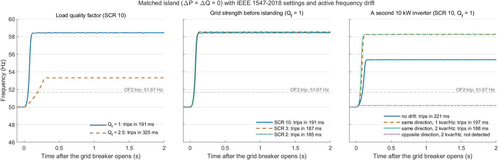

Reading the results:

- **Two inverters can cancel each other's drift completely.** A neighbouring unit with the same slope and the opposite sign removes the drift, and a matched island is again invisible.
- **On a weak grid the drift breaks fault ride-through.** At SCR 2 during a deep sag, the drift's positive feedback is no longer held down by the grid, and the inverter trips on an event IEEE 1547-2018 requires it to ride through.
- Drift still copes with a higher load quality factor, but takes up to two and a half times as long.
- Together these give the ML detector its purpose: a passive detector, with no injection, that does not depend on what neighbouring inverters do and does not destabilise a weak grid.

**Dataset** (`make_dataset.m`, `operating_conditions.m`). Sixteen operating conditions, four grid strengths (SCR 20, 10, 5, 3) by four PV/wind mixes (18.6, 10.6, 11.2 and 6.8 kW at the PCC), each with 25 cases, all with frequency drift off:

- **14 islands**: Q_f 1 and 2.5, each at seven mismatches (ΔP, ΔQ) = (0, 0), (±5%, 0), (0, ±2.5%), (+15%, +5%), (−15%, −5%).
- **11 ordinary events**: the disturbances of step 4, scaled to each condition, with the same local load in place.
- Event times are spread over one 20 ms cycle so the point on the wave varies. 400 cases, 224 islands and 176 ordinary events (`data/raw/`, not in git; index in `results/dataset_index.csv`).

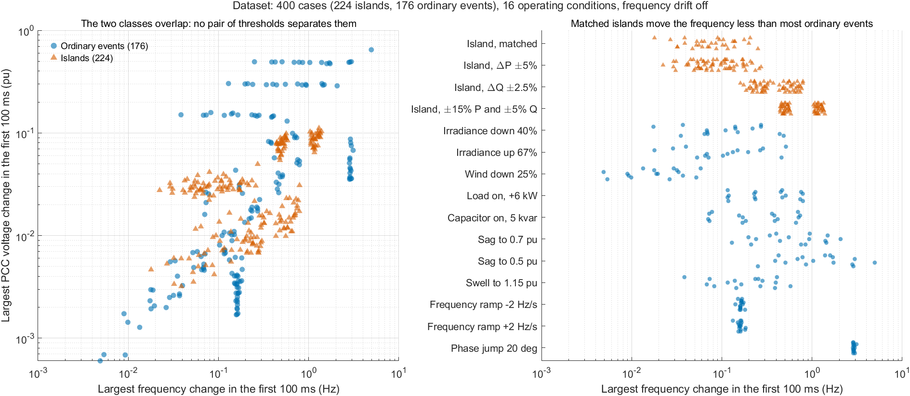

| Detector on the dataset (`dataset_baselines.m`) | Islands detected (224) | Median detection time | Ordinary events tripped (176) |
|---|---|---|---|
| Fast passive | 186 | 14 ms | 154 |
| IEEE passive | 0 | none within 0.35 s | 0 |

The fast relay misses 38 islands, all matched or nearly matched, and still trips on 154 of the 176 ordinary events. The classifier of step 6 has to work exactly where both relay families fail.

## Step 6: a passive classifier tested on unseen operating conditions ✅

**How the detector works.** Every 5 ms it takes the latest window of measurements and compares it with the 40 ms before (`window_features.m`). Everything it uses is measured at the inverter's own terminals: PCC voltage, its own current, its PLL frequency, DC-link voltage and its d/q currents. There are 22 features, all changes from the baseline, so the operating point itself is never a feature:

- voltage magnitude and frequency changes, and rate of change of frequency;
- phase jump and positive- and negative-sequence voltage and current, from a least-squares fit of the 10 kHz waveforms;
- active and reactive power changes;
- voltage and current distortion, and a distortion-impedance ratio;
- DC-link voltage and d/q current deviations.

**How it is tested.** Cases are never split between training and testing; every test case comes from an operating condition the model never saw. One family of folds holds out each grid strength in turn, the other each PV/wind mix. Each test case is replayed window by window, as a relay in service would see it (`replay_detector.m`). Four models were trained at window lengths of 10, 20 and 40 ms: a decision tree, a random forest, an SVM and a small neural network (`train_classifiers.m`). The setting was chosen by a rule fixed in advance on the mix folds (no steady-state alarm, at most 2% false trips, then the most islands detected) and reported on the grid-strength folds.

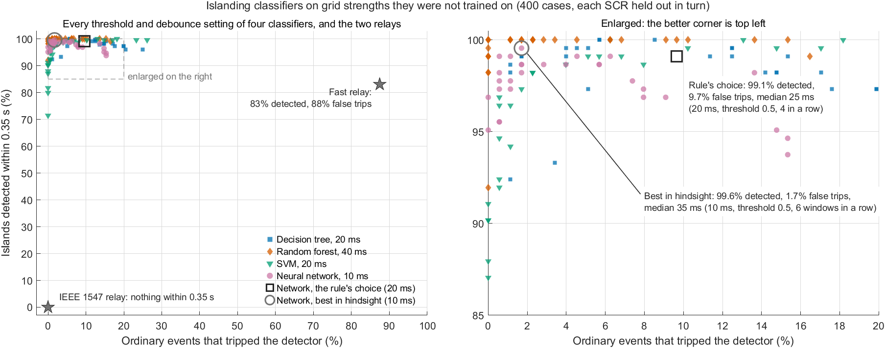

Each point is one model, window and threshold; the best detectors sit top left (many islands, few false trips).

| Detector | Islands detected (224) | Matched islands (32) | Ordinary events tripped (176) | Steady-state alarms (400) | Median detection time |
|---|---|---|---|---|---|
| **Neural network (unseen grid strength)** | **223** | **32** | **3** | **1** | **35 ms** (95% within 82 ms) |
| Fast relay | 186 | 16 | 154 | 0 | 14 ms |
| IEEE 1547 relay | 0 within 0.35 s | 0 | 0 | 0 | none |
| Active frequency drift (steps 4, 5) | all tested, except with an opposing second inverter | not detected with an opposing inverter | false trip on a weak-grid sag | 0 | 160 to 488 ms |

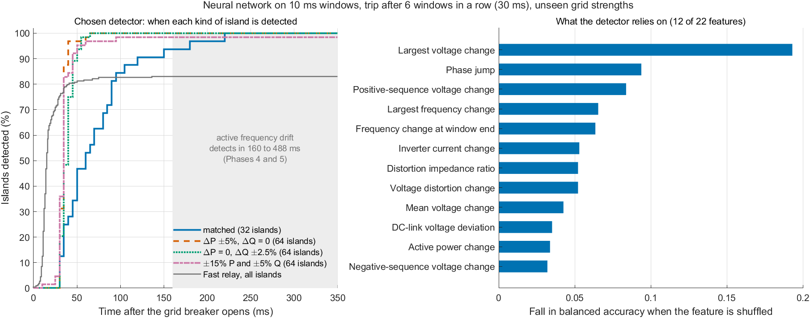

Reading the results:

- **On grid strengths inside the training range the detector made no error.** All four errors are on SCR 3, the weakest grid, which is extrapolation when SCR 3 is held out.
- **It detects islands about five times faster than active frequency drift** (median 35 ms against 160 to 488 ms) without injecting anything.
- **Matched islands are the slow ones** (median about 60 ms). The detector picks up the small voltage wander that follows when the stiff grid is gone, which is why the largest voltage change is its most important feature.
- **Two things that did not work**: a distortion-impedance feature (the RLC load's impedance is lower than the grid's at low harmonics) and a voltage-sensitivity estimate (flat across grid strengths).

## Step 7: the detector inside the model, with sensor noise, on conditions it never saw ✅

Three things were added to the test bed (`build_model.m`, sections 7d and 7e):

- **The detector runs inside the Simulink model** (the detector block pictured above) and opens the inverter's breaker through the protection's latch. Its scores match the offline computation to 5e-13 (`verify_detector.m`).
- **Sensor noise on every measurement** (the sensor-noise block pictured above): standard deviation 0.5% of rated peak voltage, 1% of rated peak current and 0.2% of the DC-link voltage at 10 kHz (`P.noise`, calibrated in `noise_calibration.m`).
- **Three operating conditions outside the dataset** (`test_conditions.m`):

| Condition | Grid strength | Irradiance, wind | Background distortion |
|---|---|---|---|
| scr15_t1 | SCR 15 | 800 W/m², 10 m/s | none |
| scr7_t2 | SCR 7 | 600 W/m², 11 m/s | 2% fifth and 1.5% seventh harmonic |
| scr4_t3 | SCR 4 (weak grid start) | 900 W/m², 7 m/s | none |

**Sensor noise breaks a detector trained without it**: it detects only 64% of islands and 38% of matched ones. Training on the same windows with measured noise added restores detection.

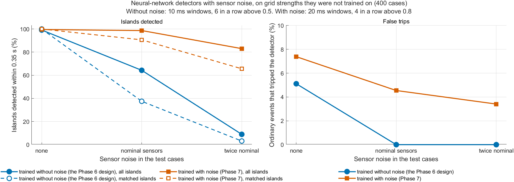

| Grid strength held out, 400 cases | Islands detected | Matched islands | Ordinary events tripped | Steady-state alarms | Median time |
|---|---|---|---|---|---|
| Trained without noise, tested without noise | 99.1% | 100% | 5.1% | 0.5% | 35 ms |
| Trained without noise, nominal sensor noise | 64.3% | 37.5% | 0% | 0% | 50 ms |
| **Trained with noise, nominal sensor noise** | **98.7%** | **90.6%** | **4.5%** | **0.25%** | **30 ms** |
| Trained with noise, twice the noise | 83.0% | 65.6% | 3.4% | 0% | 35 ms |

The chosen detector is a network on 20 ms windows that trips after 4 windows in a row score above 0.8 (`ml/islanding_classifier.mat`).

**A measurement problem that only the closed loop exposed.** The model's RMS voltage averages over a fixed 20 ms, so off 50 Hz it ripples; the first in-loop detector tripped on 2 Hz/s ramps that settled at 49 or 51 Hz. The detector now computes the positive-sequence voltage over the last cycle at the measured frequency. The first version's runs are kept in `data/closedloop/pi_v1/`.

**In the loop on the three new conditions** (`closed_loop_test.m`), with PI and with H-infinity control:

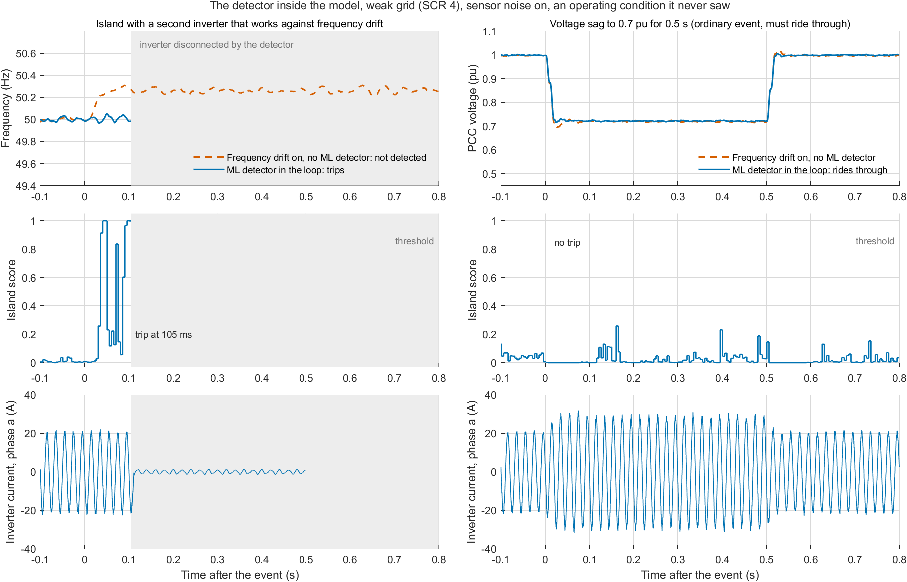

Left: an island held up by a second inverter drifting against AFD; the frequency barely moves, AFD never trips, the ML detector trips within about 100 ms. Right: a 0.5 pu sag that the detector rides through.

| Detector, 3 unseen conditions | Islands detected (30) | Islands with an opposing second inverter (3) | Ordinary events tripped (33) | Steady runs with a local load tripped (3) | Detection time |
|---|---|---|---|---|---|
| **ML in the loop, PI control** | **30** | **3** | **0** | **0** | median 30 ms, all within 105 ms |
| **ML in the loop, H-infinity control** | **30** | **3** | **0** | **0** | median 32 ms, all within 105 ms |
| Frequency drift + IEEE 1547 relay | 6 of 9 tested | 0 (none within 2 s) | 0 of 6 tested (both sags) | 0 | 168 to 200 ms |
| Fast relay | 15 before the ML trip | | 30 (26 with H-infinity) | | 7 to 19 ms |
| IEEE 1547 relay, no drift | 0 before the ML trip | | 0 | | none |

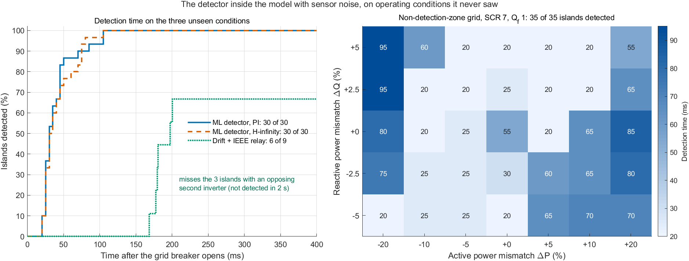

Reading the results:

- **Every island was cleared, far inside the 2 s limit**, under both controllers; the 35-point non-detection-zone grid was detected completely, all within 95 ms.
- **It catches the island that defeats active frequency drift** (3 of 3, 85 to 105 ms), because it injects nothing for a neighbour to cancel.
- **No false trip on the 33 ordinary events**; on the same signals the fast relay trips on 30.
- **The controller makes no difference to detection** (H-infinity vs PI: median difference 0 ms).
- **A weakness found: no local load.** In steady operation with a negligible local load, one run per controller tripped. The feeder training set of step 8 includes cases with no or a small household load.

## Step 8: the real feeder ✅

The unit is connected to a real Nepal Electricity Authority (NEA) feeder: the 400 V feeder of the 100 kVA Khajuri Chanha transformer at the far end of the Pidari 11 kV feeder (feeder map above). It is much more resistive than the test bed (X/R 0.43 at A5 against 3), its voltage at the recorded peak is only 0.79 to 0.85 pu, and islands can form at two points: the unit's own breaker, or the transformer breaker, which islands the whole feeder with its loads and other generation.

### 8.1 Connection-bus screening ✅

A load flow of the feeder (`feeder_loadflow.m`, `feeder_screening.m`) with a 20 kW unit at each bus in turn:


(a) hosting capacity: the largest unit that keeps every voltage at or below 1.05 pu at 30% load and every line and the transformer within rating; (b) change in feeder losses at peak; (c) voltage at A5 against feeder loading, with and without the unit, and the range in which the unit may enter service.

| Bus | SCR | X/R | Hosting capacity | Loss change at peak |
|---|---|---|---|---|
| A1 | 59.4 | 1.15 | 38.9 kW | −0.92 kW |
| A3 | 39.9 | 0.72 | 24.7 kW | −1.32 kW |
| A5 (end) | 23.6 | 0.43 | 14.4 kW | −1.32 kW |
| B3 (end) | 26.7 | 0.43 | 14.4 kW | −0.87 kW |

- **A3 is the best bus for planning**: the largest loss reduction among the buses that can host the 20 kVA unit.
- **A5 is the worst case for protection**: weakest and most resistive point, so it is the main test location; A3 is used for one test condition.
- At peak the feeder voltage is far below range (0.79 pu at A5); the unit may enter service only up to about 65% of peak load.

### 8.2 Feeder model ✅

`build_feeder_model.m` replaces the test bed's grid impedance with the feeder: an 11 kV source and upstream impedance, the transformer breaker (island point 1), the transformer, eight line sections with constant-impedance loads, a switched 10 kW load at B3, and the second inverter moved to B3 to represent the other rooftop generation on the feeder. The second inverter needed a SOGI filter on its voltage: without it, its constant-power law behaves as a negative resistance at high frequency and oscillates at 17 to 20 kHz on this lightly damped feeder.

Three test conditions, none used in training:

| Condition | Unit at | Feeder load | Irradiance, wind | Unit output | Other generation at B3 | Distortion |
|---|---|---|---|---|---|---|
| F1 | A5 | 30% of peak | 800 W/m², 10 m/s | 12.6 kW | 10 kW | none |
| F2 | A5 | 50% | 600 W/m², 11 m/s | 12.2 kW | 22 kW | 5th/7th harmonics |
| F3 | A3 | 60% | 900 W/m², 7 m/s | 10.1 kW | 28 kW | none |

Per condition: 4 islands at the unit's breaker, 5 islands of the whole feeder (the natural one with the unit alone, and 4 balanced ones with the other generation on), 1 feeder island whose other generation drifts against AFD, 13 ordinary events (the 11 of step 4 plus the 10 kW load at B3 switched on and off, with a 2 kW household load at the PCC) and 2 steady runs; plus a 35-point mismatch grid at F1. Sensor noise is on throughout.

### 8.3 The original detector on the feeder, PI ✅

The detector of step 7, unchanged (`feeder_closed_loop.m`, `results/feeder_closed_loop_pi.csv`):

| On F1–F3 | Original detector | Frequency drift + IEEE relay | Fast relay |
|---|---|---|---|
| Unit's islands (12) | **12/12**, median 35 ms | 3/3 tested, 168–178 ms | 8/12 |
| Feeder islands (15) | **15/15**, median 30 ms; natural islands 130–155 ms | 4/6 tested, 192–746 ms (misses Q_f 2.5 at F2, F3) | 10/15 |
| Feeder islands with opposing drift (3) | **3/3** | **0/3** | 1/3 |
| Mismatch grid at F1 (35) | **35/35**, within 105 ms | – | – |
| Ordinary events tripped (39) | **9/39** | 0/6 tested (sags) | 19/39 |
| Steady runs tripped (6) | 0/6 | – | – |

Every island was caught by a detector that never saw this feeder, including those that defeat frequency drift. But it **false-trips on all load switching near the unit**: the 6 kW load at the PCC and the 10 kW load at B3 switched on and off, at every condition.

### 8.4 Feeder training set and retraining ✅

124 feeder cases (`feeder_dataset.m`) at four other conditions that share no pole, loading or generation mix with F1–F3 (A3 never used): islands at both points, the natural island, the 11 events with a household or no local load, loads of 5 and 15 kW switched on and 10 kW off at B3, and steady runs. The same network, windows, threshold and debounce were retrained on the 400 test-bed cases plus these, with and without sensor noise (`feeder_retrain.m`, `ml/islanding_classifier_feeder.mat`). Offline replay, nominal noise:

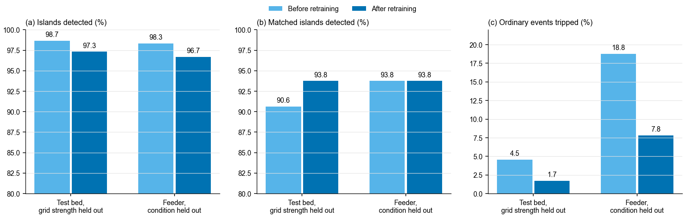

| Evaluation | Islands | Matched islands | False trips | Steady alarms | Median |
|---|---|---|---|---|---|
| Original detector on the feeder cases | 98.3% | 93.8% | 18.8% | 0% | 35 ms |
| Retrained, feeder condition held out | 96.7% | 93.8% | **7.8%** | 0% | 30 ms |
| Retrained, test-bed grid strength held out | 97.3% | 93.8% | **1.7%** | 0.25% | 30 ms |
| *Step 7 detector, test-bed grid strength held out* | *98.7%* | *90.6%* | *4.5%* | *0.25%* | *30 ms* |

Retraining cut false trips on unseen feeder conditions from 18.8% to 7.8% offline, and also improved the test bed (4.5% to 1.7%, matched islands 90.6% to 93.8%), at a cost of about 1.5 points of islands detected.

### 8.5 and 8.6 The retrained detector in the loop, PI and H-infinity ✅

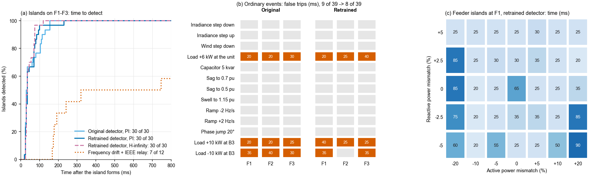

(a) Share of islands detected against time after the island forms, on F1–F3: every detector setting catches all 30, the retrained one catches the natural feeder islands much sooner; frequency drift catches 7 of the 12 it was tested on. (b) Every ordinary event at each condition, PI control: orange cells are false trips, with the time to trip in ms. (c) Detection time over the mismatch grid for feeder islands at F1, retrained detector, PI.

| On F1–F3, in the loop | Original detector, PI | Retrained detector, PI | Retrained detector, H-infinity |
|---|---|---|---|
| Unit's islands (12) | 12/12, median 35 ms | 12/12, median 35 ms | 12/12, median 30 ms |
| Feeder islands (15) | 15/15, median 30 ms | 15/15, median 30 ms (one at 230 ms) | 15/15, median 35 ms |
| Natural feeder islands (3 of the 15) | 130–155 ms | **25–35 ms** | **25–35 ms** |
| Islands with opposing drift (3) | 3/3 | 3/3 | 3/3 |
| Slowest island | 155 ms | 230 ms | 120 ms |
| Mismatch grid at F1 (35) | 35/35, max 105 ms | 35/35, **max 90 ms** | not run |
| Steady runs tripped (6) | 0/6 | 0/6 | 0/6 |
| **Ordinary events tripped (39)** | **9/39** | **8/39** | **8/39** |

Reading the results:

- **Islands: better.** All still caught; natural feeder islands about five times faster.
- **The controller makes no difference.** With H-infinity the same 30 islands are caught (median 35 ms, all within 120 ms) and the same 8 load-switching events trip.
- **False trips: not fixed in closed loop.** Despite 7.8% offline, the same load-switching events still trip in the loop on F1–F3 (8 of 9). On this resistive feeder a load step close to the unit is large next to the unit's 10–12 kW output, and its first 20–40 ms look like an island to a detector that measures only at the unit. More examples of the same kind were not enough. This led to decision 1 and step 9.

### 8.7 The retrained detector back on the test bed ✅

The feeder-trained detector (`ml/islanding_classifier_feeder.mat`) rerun on the three test-bed conditions of step 7, every case and steady run, with PI and with H-infinity (`closed_loop_test.m`, `results/closed_loop_pi_islanding_classifier_feeder.csv`, `results/closed_loop_hinfinity_islanding_classifier_feeder.csv`):

| 3 test-bed conditions | Step 7 detector, PI | Step 7 detector, H-infinity | Retrained, PI | Retrained, H-infinity |
|---|---|---|---|---|
| Islands detected (30) | 30, median 30 ms, max 105 | 30, median 32 ms, max 105 | 30, median 30 ms, max 230 | 30, median 30 ms, max 115 |
| Islands with an opposing second inverter (3) | 3 | 3 | 3 | 3 |
| Ordinary events tripped (33) | 0 | 0 | 0 | 0 |
| Steady runs with a local load tripped (3) | 0 | 0 | 0 | 0 |
| Steady runs with no local load tripped (3) | 1 (SCR 4) | 1 (SCR 7) | **0** | 1 (SCR 7) |

- **Nothing is lost on the test bed.** The retrained detector still catches all 30 islands, including the 3 that defeat frequency drift, with no false trip on the 33 ordinary events, under both controllers.
- **One slower island**: with PI, the SCR 7 island at Q_f 1.8 with a second inverter took 230 ms (was 105 ms), still far inside 2 s.
- **The no-load weakness is reduced, not gone**: with PI no steady no-load run tripped (was 1 of 3); with H-infinity the SCR 7 no-load run still tripped. The scores before arming in no-load operation remain close to the threshold, so the no-load case needs its own fix (step 9 helps here too, because an alarm no longer trips by itself).

### 8.8 The four current controllers on the feeder ✅

The comparison of step 3 repeated on the feeder (`feeder_controllers.m`): stability margins of the current loop with the feeder's short-circuit impedance behind A1, A3 and A5 (`results/feeder_margins.csv`), and runs at F1–F3 with a 2 kW household load and an irradiance drop to 60% at 0.6 s (`results/feeder_controllers.csv`).

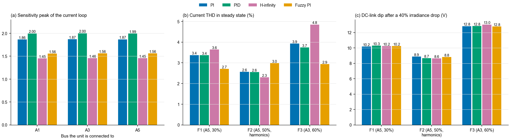

| Controller | Gain margin (A1 / A3 / A5) | Sensitivity peak | Current THD F1 / F2 / F3 | DC-link dip F1 / F2 / F3 | DC-link settling |
|---|---|---|---|---|---|
| PI | 7.3 / 7.3 / 7.4 dB | 1.86–1.87 | 3.4 / 2.6 / 3.9% | 10.2 / 8.9 / 12.8 V | 107–134 ms |
| PID | 6.6 / 6.6 / 6.7 dB | 1.99–2.00 | 3.4 / 2.6 / 3.7% | 10.3 / 8.7 / 12.8 V | 115–134 ms |
| H-infinity | 10.6 / 10.6 / 10.7 dB | 1.45–1.46 | 3.6 / **2.3** / 4.8% | 10.2 / 8.6 / 13.0 V | 115–134 ms |
| Fuzzy PI | 9.7 / 9.7 / 9.7 dB | 1.56 | **2.7** / 3.0 / **2.9%** | 10.2 / 8.8 / 12.8 V | 107–134 ms |

Reading the results:

- **The feeder hardly changes the current loop.** Margins are the same at A1, A3 and A5 to within 0.1 dB and close to the test bed's (step 3): the feeder's impedance (SCR 24 to 59) is small next to the LCL filter's, and its low X/R does not matter to the loop.
- **The ranking of step 3 holds.** H-infinity has the best margins (sensitivity peak 1.45), fuzzy PI second (1.56), PI 1.87, PID the worst (2.0).
- **Fuzzy PI gives the lowest distortion** at F1 and F3 (2.7 and 2.9% against 3.4 to 4.8%); H-infinity the lowest at F2, where the grid itself carries 5th and 7th harmonics, but the highest at F3 (4.8%). Current THD is higher than on the test bed (1 to 2%) because the unit runs at 10–12 kW of its 20 kVA rating, so the same ripple is a larger fraction of the current. All stay below the 5% IEEE 1547 limit.
- **The DC-link response is set by the DC-link loop, not the current controller**: every controller gives the same dip (8.6 to 13.0 V) and settling time (107 to 134 ms).
- No controller tripped or lost synchronism at any feeder condition.

## Step 9: ML-triggered confirmation (decision 1) ✅

**Goal:** no false trip on load switching, without losing the detector's speed or its immunity to a neighbour's drift.

**How it works.** The network's alarm (4 windows in a row above 0.8) no longer trips the inverter by itself. It starts a confirmation inside the same detector block (`build_model.m` section 7e, settings `P.ml.confirm`):

1. **Nudge**: the q-axis current reference steps by −0.25 pu of rated current (−10.2 A, about 5 kvar) for 30 ms.
2. **Measure**: the PCC voltage angle is taken from the positive-sequence phasor of the last cycle (demodulated at 50 Hz) just before the nudge and at its end; the drift of the two cycles before the nudge is removed.
3. **Decide**: if the angle moved by more than 0.05 rad, it is an island and the inverter trips. Otherwise the nudge ends, the alarm resets, and no new alarm is taken for 60 ms (until the nudge has left the detector's windows).

Why the angle tells them apart: with the grid connected, the nudge only adds a small voltage drop across the grid's resistance, Δφ ≈ R·ΔI<sub>q</sub>/V<sub>pk</sub> ≈ 0.31 Ω × 10.2 A / 326 V ≈ 0.01 rad at A5. In an island nothing holds the voltage: the load must take the extra reactive current, so the voltage angle swings by about atan(ΔI<sub>q</sub>/I<sub>d</sub>) (0.4 rad for the unit alone) and the frequency starts to run. Unlike frequency drift, the nudge is applied only after an alarm and only for 30 ms, so it costs nothing in normal operation, and it is a step far faster than a neighbour's frequency-proportional drift, which therefore cannot cancel it.

**Setting the threshold** (`confirm_pilot.m`, `results/confirm_pilot.csv`): 31 runs with the confirmation on and no threshold, so every alarm trips after one nudge and reports its response: the 8 load-switching events that tripped in step 8.5, the hardest islands of each feeder condition (unit's island at Q<sub>f</sub> 1.8, natural, matched and opposing-drift feeder islands), the test-bed islands with a second inverter, and the no-load steady run that tripped in step 8.7. Grid-connected alarms moved the angle by 0.006–0.016 rad, islands by at least 0.185 rad. 0.05 rad sits about 3× above the one and 3.7× below the other. These runs used the test conditions with other noise seeds than the evaluation below, so the threshold was set with knowledge of those conditions; the wide margin on both sides is what makes this acceptable.

**Results** (`run_feeder('confirm')`: the retrained detector of step 8.4 with the confirmation, on exactly the cases and noise seeds of steps 8.5–8.7; `results/*_islanding_classifier_feeder_confirm.csv`):

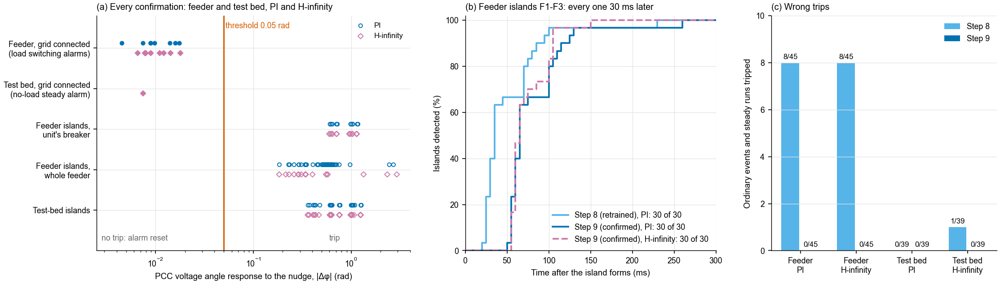

(a) Every confirmation in the 323 runs: filled markers are the 17 grid-connected alarms, all below the threshold; open markers are islands, all far above it. (b) Feeder islands F1–F3: every detection is exactly 30 ms later than in step 8, the length of the nudge. (c) Ordinary events and steady runs that tripped, step 8 against step 9.

| | Feeder, PI | Feeder, H-infinity | Test bed, PI | Test bed, H-infinity |
|---|---|---|---|---|
| Islands detected (30) | 30 → **30** | 30 → **30** | 30 → **30** | 30 → **30** |
| Median / slowest detection (ms) | 35 / 230 → 65 / 260 | 35 / 120 → 65 / 150 | 30 / 230 → 60 / 260 | 30 / 115 → 60 / 145 |
| Islands with opposing drift (3) | 3 → 3 | 3 → 3 | 3 → 3 | 3 → 3 |
| Mismatch grid at F1 (35) | 35, max 90 → 35, max 120 ms | – | – | – |
| **Ordinary events tripped** | **8/39 → 0/39** | **8/39 → 0/39** | 0/33 → 0/33 | 0/33 → 0/33 |
| Steady runs tripped (6) | 0 → 0 | 0 → 0 | 0 → 0 | **1 → 0** |
| Alarms rejected by the confirmation | 8 | 8 | 0 | 1 |

Each cell is step 8 (retrained detector) → step 9 (with the confirmation).

Reading the results:

- **The load-switching false trips are gone.** All 16 alarms on load switching near the unit (8 per controller) were rejected; their angle responses were 0.005–0.018 rad. The test-bed no-load alarm under H-infinity (step 8.7) was rejected too (0.007 rad), so the no-load weakness of steps 7 and 8 is also removed.
- **Every island was still detected, each at its first nudge**: 120 islands and 35 mismatch-grid points, the smallest response 0.18 rad (a whole-feeder island with Q<sub>f</sub> 1.8). That includes the islands that defeat frequency drift (3 of 3 on the feeder and on the test bed, under both controllers).
- **The cost is a fixed 30 ms.** Every detection is exactly 30 ms later than in step 8; the median is now 60–65 ms. Two of 120 islands took 260 ms (under PI: the 3 % mismatch feeder island at F2 and the SCR 7 island with a second inverter at Q<sub>f</sub> 1.8), because the network's alarm itself came late (230 ms), not because of the confirmation. The 150 ms target was met by 118 of 120 islands; all are far inside the 2 s of IEEE 1547-2018.
- **The nudge costs little when it is a false alarm.** It was used 17 times in the 168 grid-connected runs (ordinary events and steady runs). On the feeder it lowered the PCC voltage by at most 0.8 % and moved the PLL frequency by at most 0.13 Hz, for 30 ms; on the test bed at SCR 7 (X/R 3) by 3.9 %. No relay acted on it.
- **The controller still makes no difference** to what is detected or rejected.

Files: `use_confirmation.m` (switch it on), `confirm_summary.m` (the nudges of a saved run), `confirm_pilot.m` (threshold), `confirm_check.m` (rebuild and check that with the confirmation off the model is unchanged).

## Step 10: paper ⏳

A full draft in IEEE Transactions format is written, with a writer's guide for the co-author who will finish it. The draft text stays local until submission; its figures are in `paper/figures/` (SVG for the PDF, 300 dpi PNG for Word), drawn at journal size by `python paper/make_figures.py` from `results/` and `paper/figdata/`. Still to go in: the feeder results of steps 8.3 to 8.8 in the text, step 9, a check of every reference, and a comparison table against recent published ML islanding methods.

### Journal figures

**Fig. 1, workflow.** Steps 1 to 6 design the test bed, the baselines and the detector; steps 7 and 8 test the frozen detector on conditions and on a network it was never trained on.

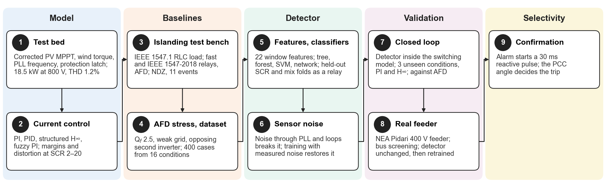

**Fig. 2, test system and detector.** CB1 is the inverter's breaker, opened by the passive protection or by the ML detector through a common latch that also blocks both boost converters. CB2 opens to form the island. The second inverter and the switched load and capacitor are connected only in the tests that need them; drift (AFD) is used only in the baseline runs.

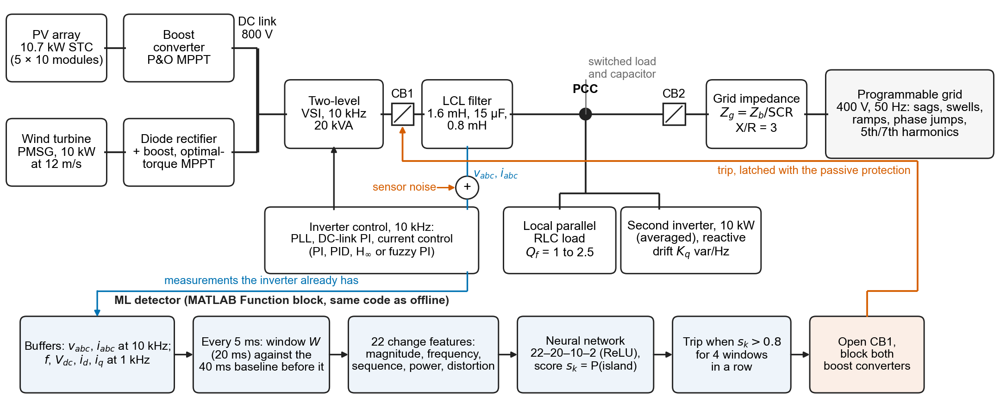

**Fig. 3, source models.** (a) Current and (b) power of the PV array against its voltage at 25 °C and 200–1000 W/m², with the maximum power points and the range the tracker allows. (c) Power coefficient of the wind turbine against tip-speed ratio. (d) Turbine power against rotor speed at 6–12 m/s, and the optimal-torque tracking curve.

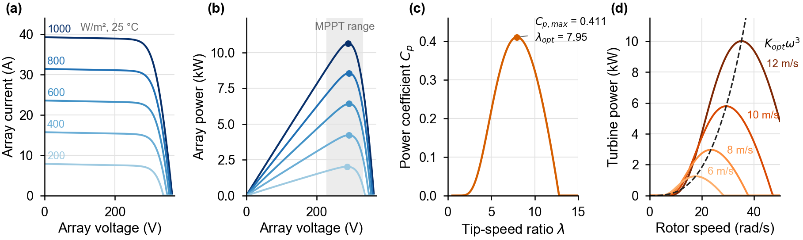

**Fig. 4, control of the converters.** (a) PV boost converter with perturb-and-observe tracking. (b) Wind chain with optimal-torque current control of its boost converter. (c) Grid inverter: PLL, DC-link voltage loop, the four selectable current controllers, and the protection that disconnects the unit.

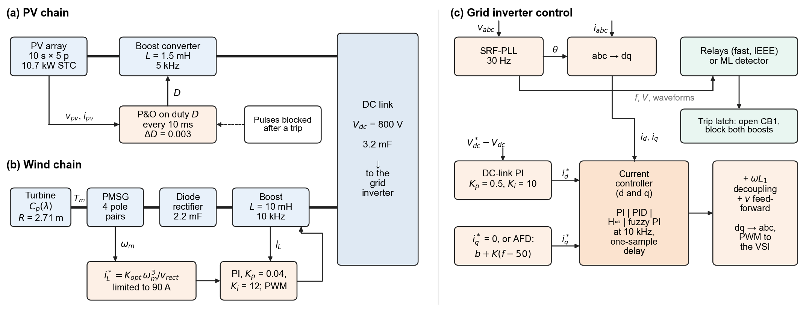

**Fig. 5, current controllers.** (a) Gain margin and (b) sensitivity peak of the current loop against grid strength. (c) Grid-current distortion after a hard start at full power (SCR 20, 10, 5) and after a power ramp on a weak grid (SCR 3, 2). H-infinity is the most robust; fuzzy PI has the lowest distortion on a weak grid.

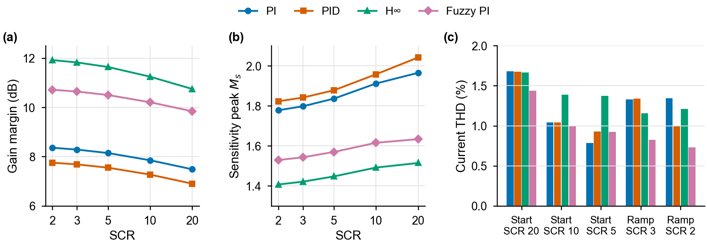

**Fig. 6, the feeder.** (a) Pidari 11 kV feeder from Mujeliya substation, nodes coloured by load-flow voltage at the recorded peak. (b) The 400 V feeder of the 100 kVA Khajuri Chanha transformer, with the two islanding points: the transformer's 11 kV side (the whole feeder islands) and the unit's own breaker.

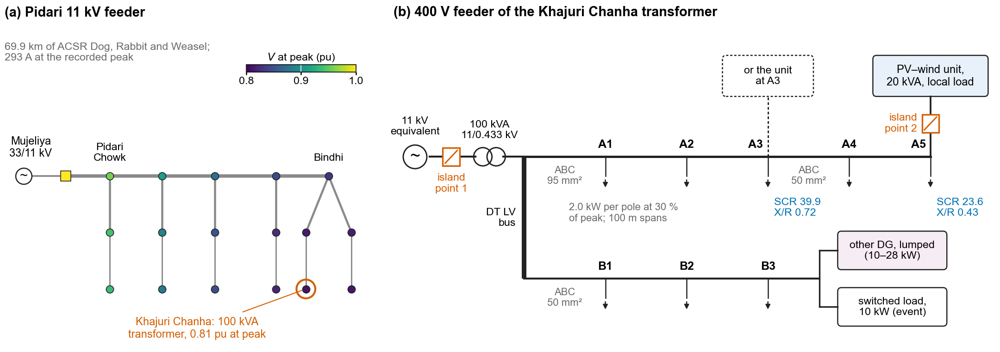

**Fig. 7, choosing the connection point.** (a) Hosting capacity of each pole. (b) Change in feeder losses at the peak with a 20 kW unit. (c) Voltage at A5 against feeder loading without and with the unit; the shaded band is where IEEE 1547-2018 lets a DER enter service.

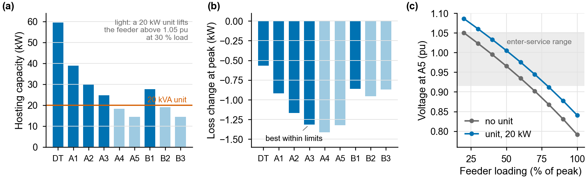

**Fig. 8, non-detection zone of the passive relays.** Detection time over the mismatch plane at SCR 10, Q<sub>f</sub> = 1, in ms after CB2 opens (ND: not detected within 2 s). Near-matched islands are not seen.

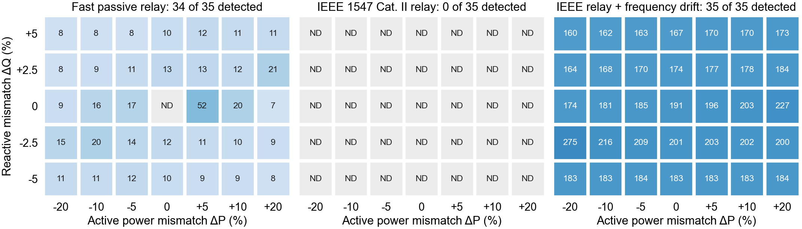

**Fig. 9, why a fast ROCOF relay false-trips.** ROCOF after an island with ΔQ = +2.5 % (left) and after four ordinary disturbances at SCR 10: every trace crosses the 2 Hz/s threshold, so a relay fast enough for islands also trips on ordinary events.

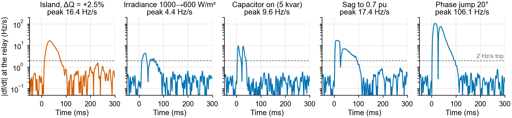

**Fig. 10, where active frequency drift fails.** Frequency after a matched island with AFD and the IEEE relay, against (a) load quality factor, (b) grid strength, (c) a second 10 kW inverter whose drift works with or against the main inverter's, and (d) PLL frequency during a 0.7 pu sag at SCR 2 with and without AFD, grid connected. An opposing neighbour cancels AFD, and AFD destabilises a weak grid during a sag.

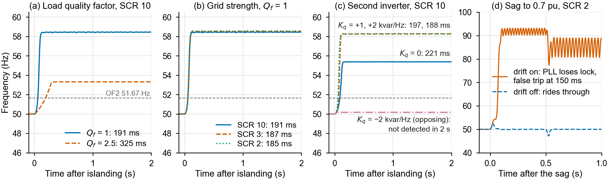

**Fig. 11, sensor noise.** Islands detected and ordinary events tripped on unseen grid strengths against sensor noise, for a network trained without noise (W = 10 ms, θ = 0.5, D = 6) and one trained with measured noise (W = 20 ms, θ = 0.8, D = 4). Training with noise is what makes the detector usable.

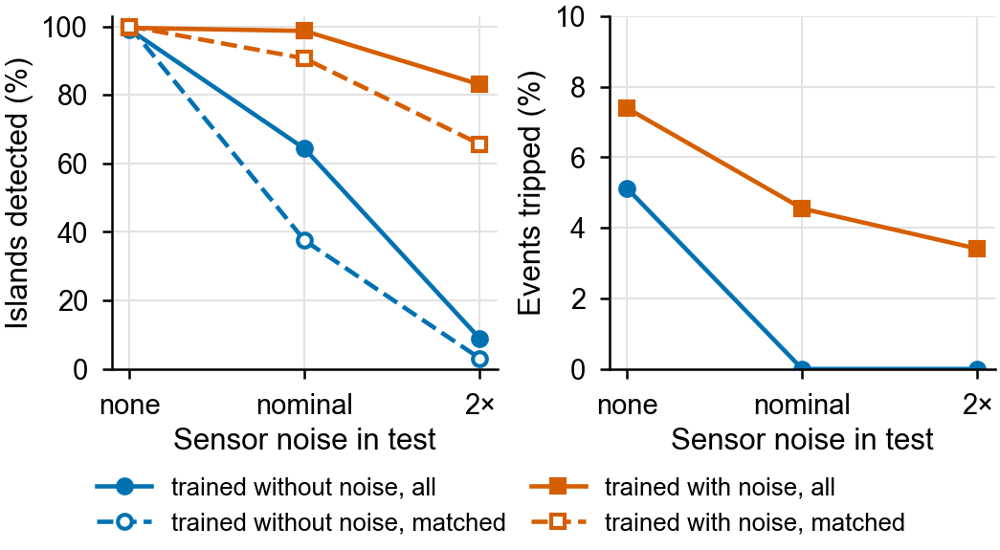

**Fig. 12, what the detector looks at.** Permutation importance of the 12 most important of the 22 features, mean over the four held-out grid strengths with the range across them.

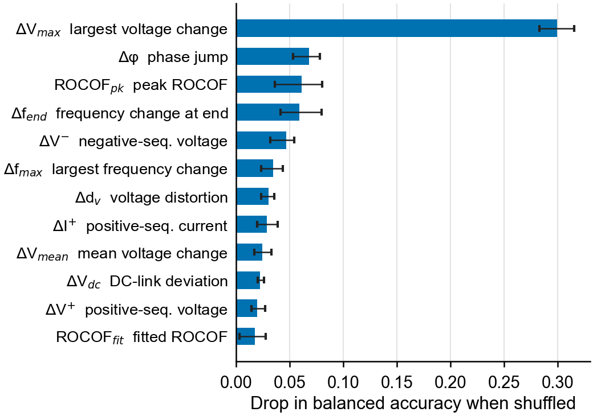

**Fig. 13, the detector in the loop.** SCR 4 (condition T3) with sensor noise. (a) An island held up by a second inverter whose drift opposes AFD: with AFD alone the frequency settles near 50.25 Hz and the island is not detected in 2 s; the ML detector trips after 105 ms. (b) A sag to 0.7 pu for 0.5 s, ridden through with and without the ML detector. Middle row: island score; bottom row: inverter current.

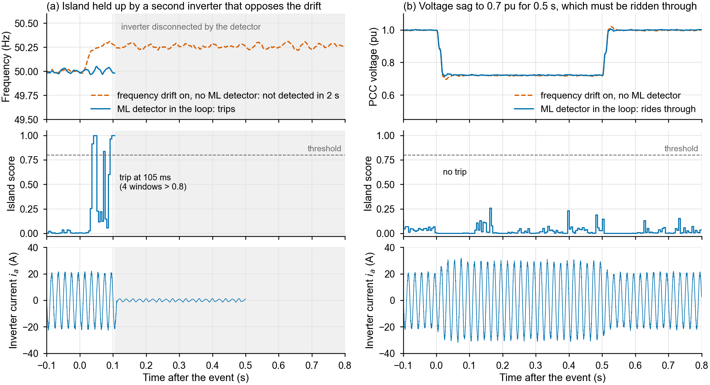

**Fig. 14, closed-loop results on the test bed.** (a) Detection time of the in-loop detector on the 30 islands of the three unseen conditions under PI and H-infinity control, and of AFD with the IEEE relay on 9 islands. (b) Detection time over the mismatch grid at SCR 7 with background harmonics (T2), PI control.

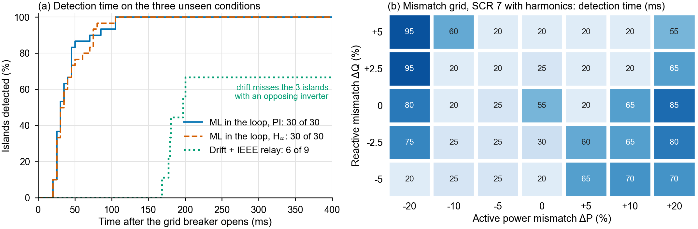

**Fig. 15, the retrained detector on the real feeder (step 8.5 and 8.6).** (a) Detection time on the feeder for the unit's islands and the whole-feeder islands with PI, all 30 islands with H-infinity, and drift with the IEEE relay (7 of 12; it misses every island with an opposing neighbour and most at Q<sub>f</sub> = 2.5). (b) Detection time of whole-feeder islands over the mismatch grid at F1, PI control: all 35 caught within 90 ms.

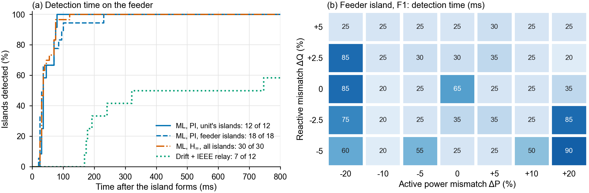

---

## Known limitations

- PI and PLL gains are a first pass, not optimised.
- PV current readings are unreliable when the PV voltage is far above its operating point, including after a trip.
- Generator stator inductance (3 mH) and rotor inertia (10 kg m²) were changed from the original so the machine can deliver 10 kW through a diode rectifier.
- Simulation only, with one sensor-noise model (white noise at the control rate); real sensors also drift and saturate. No hardware-in-the-loop test yet.
- On the real feeder the network alone trips on load switching near the unit (8 of 39 events after retraining); the confirmation of step 9 removes these trips at the cost of 30 ms and a brief reactive-current nudge after each alarm. Its threshold was set on runs of the same test conditions (other noise seeds), with a margin of about 3× on both sides.
- The confirmation was tested with an averaged neighbouring inverter and one feeder. A neighbour that reacts within 30 ms (for example a fast volt-var or frequency-watt controller) or a much stiffer island could shrink the island's angle response; the smallest seen was 0.18 rad against a 0.05 rad threshold.
- The second inverter is an averaged current source with ideal current control, not a switching model.
- The detector was trained with PI current control only; H-infinity control did not change its results, but PID and fuzzy PI were not tested in the loop.

## Repository layout

```
hybrid_pv_wind_islanding.slx   Corrected test-bed model (R2024b), built by scripts/build_model.m
hybrid_pv_wind_feeder.slx      The unit on the real feeder, built by scripts/build_feeder_model.m
MATLAB_R2018a/                 Original Simulink models, saved in R2018a (kept unchanged)
Real_model/                    The NEA feeder data and load flow the feeder scripts read
scripts/params.m               Every rating, gain and test setting in one place
scripts/build_model.m          Rebuilds the corrected model from the original, change by change
scripts/run_model.m            Runs a model and reports power, DC link, frequency, distortion, trip
scripts/run_baseline.m         Runs the original model for the before/after comparison
scripts/export_diagrams.m      Saves the model diagrams to docs/
scripts/readme_figures.py      Draws docs/steps.png and the feeder and step 9 figures from the result tables
scripts/plant_model.m          Current-loop plant: inverter, LCL filter, grid and voltage feedforward
scripts/loop_margins.m         Stability margins of the current loop
scripts/analyze_pi.m           Margins of the PI baseline at each grid strength
scripts/sweep_scr.m            Simulates the PI baseline at each grid strength
scripts/softstart_scr.m        Weak-grid test with power ramped up after start
scripts/signal_metrics.m       Power, distortion, DC-link and frequency figures from a run
scripts/plot_pi_bode.m         Draws docs/pi_loop_bode.png
scripts/plot_islanding.m       Draws docs/islanding_matched.png
scripts/design_hinf.m          Structured H-infinity current controller design
scripts/hinf_controller.mat    The designed controller, read by params.m
scripts/compare_controllers.m  All four current controllers on the same test suite
scripts/plot_controller_sensitivity.m  Draws docs/controller_sensitivity.png
scripts/design_pid.m           PID current controller (baseline PI plus filtered derivative)
scripts/design_flc.m           Fuzzy PI current controller
scripts/discrete_plant.m       Current-loop plant as the digital controller sees it
scripts/margins_all.m          Margins of all four controllers at each grid strength
scripts/plot_controller_comparison.m  Draws docs/controllers_sensitivity.png and docs/controllers_step.png
scripts/demo_hinf.m            Walk-through of the H-infinity controller; draws docs/hinf_demo.png
scripts/detect_islanding.m     Replays logged voltage and frequency through a set of relay settings
scripts/island_case.m          Sizes the RLC load for a given active/reactive mismatch
scripts/afd_sign_test.m        Matched island with no drift and with drift of each sign
scripts/ndz_sweep.m            Non-detection-zone sweep (70 runs); evaluate_ndz.m scores it
scripts/false_trip_test.m      Eleven non-islanding disturbances through every detector
scripts/plot_ndz.m             Draws docs/ndz_maps.png
scripts/plot_phase4.m          Draws the island, ROCOF and detector-summary figures
scripts/disturbance_events.m   The eleven ordinary disturbances used for false-trip tests
scripts/relay_signals.m        Voltage, frequency and ROCOF as a relay sees them
scripts/run_phase5.m           Runs every step 5 stage in order
scripts/operating_conditions.m The sixteen operating conditions; condition_params.m sets one up
scripts/operating_points.m     Inverter output at each condition, used to size islanding loads
scripts/afd_stress.m           Active frequency drift under high Q_f, weak grid and a second inverter
scripts/make_dataset.m         The 400-case labelled dataset in data/raw/
scripts/dataset_baselines.m    The passive relays on the dataset's windows
scripts/reduce_run.m           Keeps a run's 1 ms signals for detector replay
scripts/plot_phase5.m          Draws docs/afd_stress.png and docs/dataset_overview.png
scripts/window_features.m      The 22 features of one measurement window
scripts/extract_features.m     Sliding-window features for every case (data/features/), test bed or feeder
scripts/train_classifiers.m    Four classifiers, tested on held-out grid strengths and PV/wind mixes
scripts/replay_detector.m      Replays classifier scores case by case as a relay
scripts/final_classifier.m     Feature importance and the final trained detector
scripts/plot_phase6.m          Draws docs/ml_tradeoff.png and docs/ml_detection.png
scripts/ml_features.m          The 22 features from measurement buffers, shared by the offline code and the model
scripts/ml_pack.m              Packs the trained network into one parameter vector for the model
scripts/fit_detector.m         Trains one classifier (tree, forest, SVM or network)
scripts/run_phase7.m           Runs every step 7 stage in order
scripts/noise_calibration.m    Sensor noise as the detector sees it, through the PLL and controls
scripts/noise_study.m          Classifiers trained without and with noise, tested at three noise levels
scripts/select_detector.m      Applies the selection rule to the noise study
scripts/verify_detector.m      Checks the detector inside the model against the offline code
scripts/test_conditions.m      The three test-bed conditions outside the dataset
scripts/closed_loop_test.m     The detector in the loop on the test bed (any trained detector)
scripts/plot_phase7.m          Draws docs/noise_robustness.png, docs/closed_loop_traces.png, docs/closed_loop_summary.png
scripts/use_detector.m         Loads another trained detector into the model's parameters
scripts/run_feeder.m           Runs every step 8 and step 9 stage in order (finished cases are skipped)
scripts/feeder_loadflow.m      Backward/forward sweep load flow of the 400 V feeder
scripts/feeder_screening.m     Connection-bus screening and operating window
scripts/build_feeder_model.m   Builds hybrid_pv_wind_feeder.slx
scripts/feeder_params.m        Sets the feeder, its loading and the unit's bus; feeder_der2.m places the other generation
scripts/feeder_conditions.m    The three feeder test conditions F1-F3; feeder_condition_params.m sets one up
scripts/feeder_operating_points.m  Flows at each feeder condition, used to size feeder islands
scripts/feeder_island_case.m   Sizes a balanced island of the whole feeder
scripts/feeder_closed_loop.m   The detector in the loop on the feeder: islands, events, steady runs, AFD, mismatch grid
scripts/feeder_train_conditions.m  The four feeder training conditions
scripts/feeder_dataset.m       The 124 feeder training cases in data/raw_feeder/
scripts/feeder_retrain.m       Retrains the detector with feeder cases and replays it offline
scripts/feeder_controllers.m   The four current controllers on the feeder
scripts/use_confirmation.m     Switches on the ML-triggered confirmation of step 9 (settings in P.ml.confirm)
scripts/confirm_summary.m      The confirmation nudges of a saved closed-loop run and their angle responses
scripts/confirm_pilot.m        Step 9: the runs that set the confirmation's threshold
scripts/confirm_check.m        Step 9: rebuilds both models and checks them with the confirmation off and on
docs/                          Model diagrams and result figures
results/                       Result tables (.csv); simulation runs (.mat) are not tracked
data/                          Datasets, features and closed-loop runs, generated, not tracked
ml/islanding_classifier.mat    The step 7 detector (trained with noise), with its window, threshold and debounce
ml/islanding_classifier_noisefree.mat  The step 6 detector, trained without noise
ml/islanding_classifier_feeder.mat     The detector retrained with feeder cases (step 8.4)
paper/figures/                 The paper's figures (SVG and 300 dpi PNG)
paper/make_figures.py          Draws paper/figures/ from results/ and paper/figdata/
paper/export_figure_data.m     Writes the simulation traces the paper figures need to paper/figdata/
paper/export_feeder_data.m     Writes the feeder map data to paper/figdata/
explainer/explainer.md         Long-form explanation of the whole project (steps 1-8), every model, graph and the ML detector
explainer/build_explainer.py   Builds the explainer PDF from explainer.md (pandoc and Chrome)
explainer/video_script.py      Slide text and narration for the explainer video
explainer/make_video.py        Builds the narrated explainer video from video_script.py
explainer/ml_diagrams.py       Draws the ML network, window, fold and trip diagrams to explainer/figures/
paper/ (draft text), report/, archive/, explainer PDF and video  Kept locally, not tracked
```

To run an islanding case on the test bed:

```matlab
addpath scripts
P = params(10);            % short-circuit ratio 10
P.tIsland = 0.5;           % open the grid breaker at 0.5 s
P.load.P = 18.4e3; P.load.QL = P.load.P; P.load.QC = P.load.P;   % matched RLC load, Qf = 1
run_model(1.0, P, 'island_matched');
```

To run every feeder stage (one simulation at a time; about a day in all), or one stage, such as step 9 (about 6 hours):

```matlab
addpath scripts
run_feeder()               % every stage
run_feeder({'confirm'})    % step 9 only: the retrained detector with the confirmation
```

## Requirements

- MATLAB with Simulink and Simscape Electrical (Specialized Power Systems)
- Robust Control Toolbox
- Statistics and Machine Learning Toolbox
- Fuzzy Logic Toolbox (fuzzy PI controller)
- Python 3 with matplotlib, for `scripts/readme_figures.py`

## Authors

To be confirmed with the project team and supervisors.
