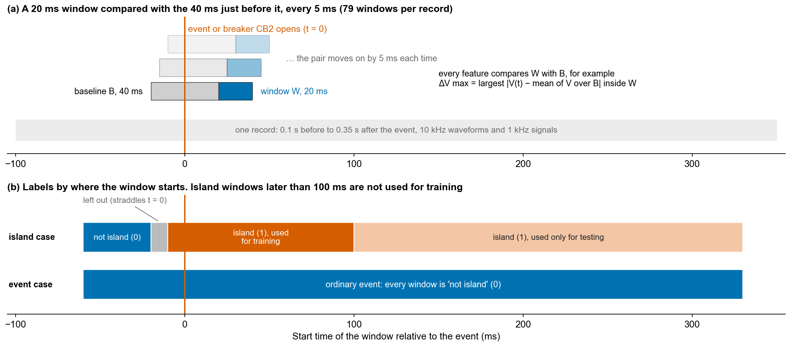
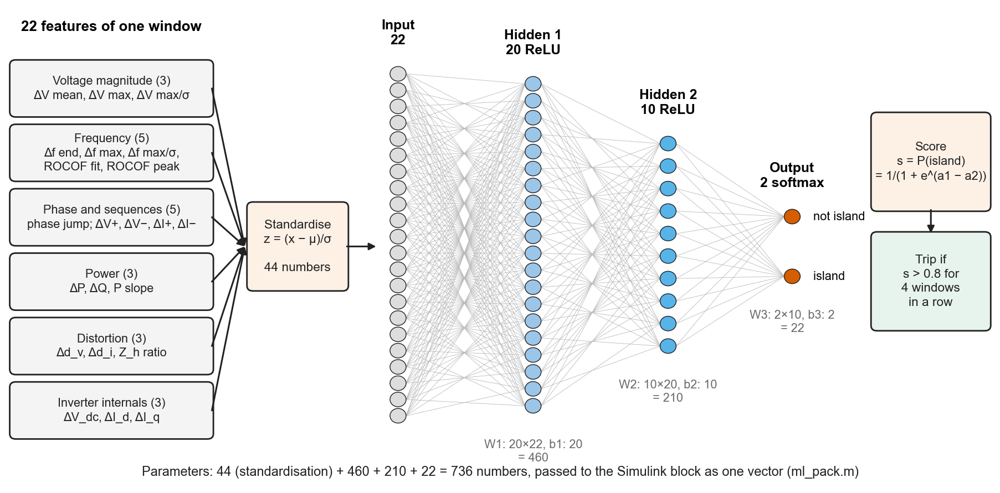
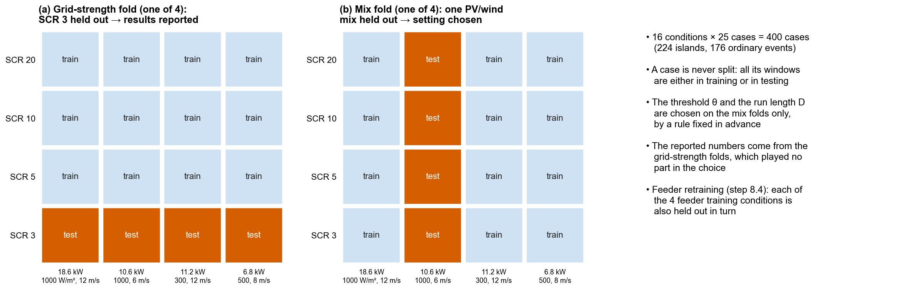
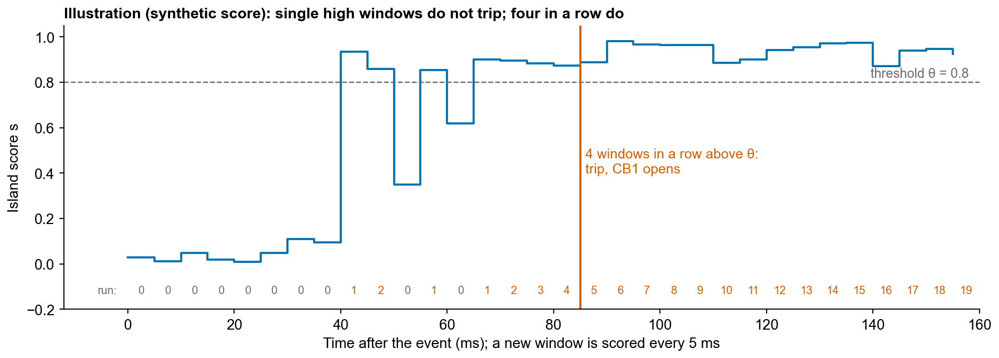

# How to read this document

::: {.cover-note}
This document explains the project from the beginning to where it stands today. It is written for the project team, supervisors and anyone who will continue the work or write the paper. Every model picture and every graph in the repository is shown, and for each one it says what it is, how to read it, what shape it has, whether that shape makes physical sense, and why it matters. Part C explains the machine-learning detector in full detail. A narrated video with the same content comes with it (`Project_Explainer.mp4`).
:::

The project is organised in ten steps. Steps 1 to 8 are complete, step 9 is the next piece of work and step 10 (the paper) is in progress. The document follows the same order:

- **Part 1** gives the project on one page, and **Part 2** the words and ideas you need (a glossary with a few simple formulas used later to check the graphs).
- **Part A** explains every model: the block diagrams and the Simulink pictures, component by component.
- **Part B** goes through steps 1 to 8. Every graph has a box like the one below.
- **Part C** explains the machine-learning (ML) detector in detail: its inputs, features, network, training, testing and how it runs inside Simulink.
- **Part D** is an honest review: which results were checked against physics, which inconsistencies were found, and the known weaknesses.
- **Part E** lists what is left, and the appendix lists where every file is.

::: graph
**What it shows.** What is plotted, in one or two sentences.

**How to read it.** Axes, colours, what a point or a line means.

**Its nature.** The shape of the curves or the pattern in the data.

**Does it make sense?** A check of that shape against simple physics or against another result.

**Why it matters.** What the graph contributes to the argument of the project.
:::

Model pictures have a similar box with **Components**, **How it works** and **What to notice**.

All figures are produced by scripts in the repository: the MATLAB scripts in `scripts/` (named in each section), `scripts/readme_figures.py` for the step and feeder figures, `paper/make_figures.py` for the journal versions, and `explainer/ml_diagrams.py` for the four new ML diagrams of Part C.

# Part 1. The project on one page

**Where it started.** The project began as a final-year group project at Nepal Engineering College: a grid-connected hybrid solar PV and wind system modelled in MATLAB/Simulink. When we examined that model it did not work as described. It never reached a steady state, the PV tracker was capped at 50 V for a 290 V array, the frequency signal climbed from 44 to 489, and the protection could never open the breaker. A corrected model of a standard system is not new enough for a journal, so the project was turned into a research question.

**The research question.** When the utility grid is disconnected, a solar or wind inverter may keep supplying the local loads on its own. This is called an **island**. It is dangerous for line workers, can damage customer equipment and causes problems when the grid reconnects. The standard IEEE 1547-2018 therefore asks two things of every inverter:

1. **detect an island and stop within 2 seconds**, and
2. **stay connected (ride through)** voltage sags, frequency swings and other ordinary disturbances, so that one grid fault does not disconnect thousands of inverters at once.

These two demands pull against each other. A relay set fast enough to catch islands also trips on ordinary disturbances. A relay set wide enough for ride-through misses islands, especially when the local load nearly matches the inverter's output. Active methods such as active frequency drift (AFD) push the frequency so that an island drifts away, but a neighbouring inverter can cancel them, and on a weak grid they can make the inverter unstable.

**Our answer.** A small neural network that uses only what the inverter already measures (its terminal voltages and currents, its frequency estimate, DC-link voltage and control currents). Every 5 ms it computes 22 "change" features over the last 20 ms, scores them, and trips the inverter when four windows in a row look like an island. It injects nothing, so nothing can cancel it.

**What we found so far.**

- On the test bed, inside the switching model, with realistic sensor noise and on grid conditions the detector never saw: **30 of 30 islands detected within 105 ms (median 30 ms)**, **0 of 33 ride-through events tripped**, including islands that AFD cannot detect. The result is the same under PI and H-infinity current control.
- Sensor noise breaks a detector trained without noise (64% of islands detected); training with realistic noise restores it (98.7%).
- On a real 400 V feeder in Nepal (the Pidari feeder of the Nepal Electricity Authority), every island is still detected, but **load switching close to the inverter causes false trips (8 of 39 events)**. Step 9, an ML-triggered confirmation, is planned to remove them.

| Step | What | Status |
|--|------------------|-----|
| 1 | Corrected test bed | Done |
| 2 | PI baseline against grid strength | Done |
| 3 | H-infinity and four current controllers compared | Done |
| 4 | Islanding test bench and baseline relays | Done |
| 5 | Frequency-drift stress tests and the 400-case dataset | Done |
| 6 | ML classifier tested on unseen conditions | Done |
| 7 | Detector inside the model, with sensor noise, in closed loop | Done |
| 8 | Real feeder (NEA Pidari, 400 V feeder of the Khajuri Chanha transformer), parts 8.1 to 8.8 | Done |
| 9 | ML-triggered confirmation, to remove the load-switching false trips (decision 1) | To do (next) |
| 10 | Paper | Draft written; feeder results and step 9 still to go in |

# Part 2. Words and ideas you need

| Term | Meaning |
|-----|----------------|
| **Island** | Part of the network (here: the inverter and its local load, or a whole feeder) that keeps running after the utility grid is disconnected. |
| **PCC** | Point of common coupling: the node where the inverter, its local load and the grid meet. |
| **CB1, CB2** | CB1 is the inverter's own breaker (opened by its protection). CB2 is the grid breaker that we open to create an island. |
| **Ride-through** | Staying connected during a disturbance the standard says the inverter must survive (sags, swells, frequency ramps, phase jumps). |
| **False trip** | The inverter disconnects although there is no island. |
| **Steady-state alarm** | The detector trips while nothing is happening at all. |
| **Mismatch ΔP, ΔQ** | Difference between the local load and the inverter output, in percent of the inverter's power. ΔP = ΔQ = 0 is a **matched island**, the hardest case. |
| **Quality factor Q~f~** | How "resonant" the parallel RLC test load is: Q~f~ = (reactive power of the capacitor)/(active power). The standard test uses Q~f~ = 1; a higher Q~f~ makes the island frequency stiffer. |
| **NDZ** | Non-detection zone: the set of mismatches for which a detector misses the island. |
| **SCR** | Short-circuit ratio: grid short-circuit power divided by the inverter rating. SCR 20 is a strong grid, SCR 2 to 3 a very weak grid. |
| **X/R** | Ratio of reactance to resistance of the grid impedance. 3 on the test bed; 0.43 to 1.8 on the real feeder (very resistive). |
| **pu** | Per unit: a value divided by its rated value (1 pu voltage = 400 V line-to-line). |
| **ROCOF** | Rate of change of frequency, in Hz/s. |
| **AFD** | Active frequency drift: the inverter adds reactive current in proportion to the frequency deviation, so an island's frequency runs away and a relay trips. |
| **IEEE 1547-2018 Category II** | The trip settings an inverter must use; wide enough for ride-through. Frequencies here are scaled from 60 to 50 Hz. |
| **PLL** | Phase-locked loop: estimates the grid angle and frequency from the measured voltage. Every relay in this project uses its frequency. |
| **MPPT, P&O** | Maximum power point tracking; perturb-and-observe is the simple tracker that steps the duty cycle and keeps the direction that raised power. |
| **LCL filter** | Inductor–capacitor–inductor filter between the inverter and the grid that removes switching ripple. |
| **d–q currents** | The inverter current seen in a frame rotating with the grid voltage: i~d~ carries active power, i~q~ reactive power. |
| **THD** | Total harmonic distortion of a current or voltage, in percent. IEEE 1547 allows 5% for current. |
| **Gain margin, phase margin, M~s~** | Robustness of a control loop. M~s~, the sensitivity peak, is the largest amplification of a disturbance; lower is more robust (below 2 is good). |
| **Feature, window, score** | A feature is one number computed from a short time window of measurements. The network turns 22 features into a score between 0 and 1. |
| **Threshold θ, debounce D** | The inverter trips when the score is above θ = 0.8 for D = 4 windows in a row. |
| **Held-out fold** | A test in which a whole operating condition (for example SCR 3) is kept out of training and used only for testing. |

**Three simple formulas used to check graphs.** For an island with a parallel RLC load:

- the island voltage follows the active-power balance. A resistive load draws P = V²/R, so V/V~0~ ≈ √(P~gen~/P~load~). A 20% active mismatch changes the voltage by only about 10%.
- the island frequency moves until the load's reactive power balances what the inverter supplies. For small changes, Δf/f~0~ ≈ ΔQ/(2·Q~f~·P). A 5% reactive mismatch with Q~f~ = 1 shifts the frequency by about 2.5%, or 1.25 Hz.
- a resonance or anti-resonance of an inductance L and capacitance C sits at f = 1/(2π√(LC)).

These explain most of the graphs below without a simulation.

# Part A. The models

## A1. The test system as a block diagram

::: model
**Components.**

- **PV array**, 10.7 kW at standard test conditions: 10 modules in series × 5 strings, each a 213 W module (60 cells, V~mp~ = 29 V). Its boost converter raises the voltage to the 800 V DC link and runs the P&O tracker.
- **Wind turbine**, 10 kW at 12 m/s, driving a permanent-magnet synchronous generator (PMSG). A diode rectifier and a boost converter feed the same DC link; the boost controls the generator current with optimal-torque tracking.
- **DC link**: 800 V, 3.2 mF, shared by both sources.
- **Inverter (VSI)**: three-phase two-level, 20 kVA, 10 kHz switching.
- **CB1**: the inverter's breaker, opened by the protection or by the ML detector.
- **LCL filter**: 1.6 mH, 15 µF (with 2 Ω damping), 0.8 mH.
- **PCC** with the **local parallel RLC load** (sized for each test), a **switched load and capacitor** (for ordinary events) and a **second inverter** (10 kW, averaged model, with optional reactive drift).
- **CB2** and the **grid impedance** Z~g~ = Z~b~/SCR with X/R = 3 (Z~b~ = 8 Ω), and a **programmable 400 V, 50 Hz source** that can make sags, swells, frequency ramps, phase jumps and 5th/7th harmonics.
- **Inverter control** at 10 kHz: PLL, DC-link PI, current control (PI, PID, H-infinity or fuzzy PI).
- **Sensor noise** added to every measurement.
- **ML detector**: buffers → window features → neural network → trip rule → opens CB1 and blocks both boost converters.

**How it works.** The PV and wind chains push power into the DC link. The inverter's DC-link controller keeps 800 V by exporting whatever arrives, so the exported power follows the sources. Opening CB2 creates an island: the inverter, its local load and possibly the second inverter are left alone. The detector watches the same measurements the inverter control already has and trips through the same latch as the passive protection.

**What to notice.** The detector needs no extra sensors and no communication. Everything the bottom row uses is already measured by the inverter.
:::

## A2. Top level of the Simulink model

::: model
**Components (left to right).**

- **Irradiance** blocks (a start limit, a step and a "min") and **cell temperature** feed the orange **PV array** block.
- **DC-DC Boost Converter with MPPT** (a subsystem, A3).
- **Wind_Subsystem** (A4), whose output joins the same DC bus.
- The **IGBT bridge** with gate signals PWM1–PWM6 from the **PWM Generator**, driven by **Inverter Control Logic** (A6).
- The **breaker with the "com" input**: CB1, driven by "Breaker trip command" from **Passive Anti-Islanding Protection** (A8).
- The **LCL filter**: series R–L branches, then the shunt R–C branches, then the second R–L branches.
- **Local load** (parallel RLC), **Switched load** and **Switched capacitor** with their breakers.
- **Second inverter control** and three **controlled current sources** (A9).
- **Breaker for Islanding Simulation** (CB2), **Grid impedance** and **Grid voltage** (the programmable source).
- Cyan blocks: **Sensor noise** (A10) and the **Machine-learning islanding detector** (A11); **Data logging** writes 15 signals to the workspace.
- **Discrete 2e-06 s**: the powergui block. The power circuit is solved with a fixed 2 µs step; the controls run at 10 kHz.

**How it works.** Signals are passed by Goto/From tags (Vabc, Igrid, Iabc, VDC, ID, IQ, freq, trip …), so every subsystem can read them without wires.

**What to notice.** This model is not drawn by hand: `build_model.m` starts from the original R2018a model and applies every correction as code. Anyone can rebuild it and see exactly what was changed.
:::

## A3. PV array, boost converter and tracker

::: graph
**What it shows.** Panels (a) and (b) are the PV array's current–voltage and power–voltage curves at 25 °C for 200 to 1000 W/m², with the maximum power points (dots) and the range the tracker allows (grey band, 230–330 V).

**How to read it.** Each curve is one irradiance. Moving right along a curve means raising the array voltage.

**Its nature.** The I–V curves are flat (constant current) and then fall steeply near the open-circuit voltage. The P–V curves rise almost linearly, peak, then drop. The current scales with irradiance; the voltage of the peak hardly moves (about 290 V).

**Does it make sense?** Yes. The single-diode model gives a current source (proportional to irradiance) in parallel with a diode, so current is nearly constant until the diode conducts. At 1000 W/m² the peak is 10.6 kW at about 290 V and 36.7 A, matching 10 × 29 V and 5 × 7.35 A from the datasheet.

**Why it matters.** It confirms the corrected PV model and shows why the tracker's range of 230–330 V always contains the peak. The original model capped the tracker at 50 V, far left of every peak, so the array produced almost nothing.
:::

::: model
**Components.** Input capacitor (with series resistance) across the array; boost inductor 1.5 mH; IGBT switch; output diode to the DC link (terminals 1 and 4); the **MPPT** MATLAB function fed by the PV voltage and current through unit delays; a **Repeating-Sequence** carrier (5 kHz) compared with the duty cycle D to make the gate pulse; an **AND** with "Not tripped" so that the pulses stop after a trip.

**How it works.** The boost converter sets the PV voltage: V~pv~ = V~dc~(1 − D). Every 10 ms the tracker changes D by 0.003. If power went up it keeps the direction, otherwise it reverses. The array therefore oscillates in a small band around its maximum power point.

**What to notice.** The trip blocks the boost pulses. After an islanding trip the sources stop pushing power into the DC link.
:::

## A4. Wind turbine, generator and tracker

Panels (c) and (d) of the figure above belong here.

::: graph
**What it shows.** (c) The power coefficient C~p~ against tip-speed ratio λ (blade-tip speed divided by wind speed). (d) Turbine power against rotor speed for 6–12 m/s, with the optimal-torque curve K~opt~ω³ (dashed) through the peaks.

**How to read it.** C~p~ is the fraction of the wind's power the rotor captures. In (d) each coloured curve is one wind speed, and the dashed curve is where the tracker keeps the turbine.

**Its nature.** C~p~ is a single hump with a maximum of 0.411 at λ = 7.95. The power curves are humps whose peaks move right and up with wind speed. The dashed curve passes through every peak.

**Does it make sense?** Yes. Turbine power is ½ρπR²v³C~p~. At 12 m/s with R = 2.71 m and C~p~ = 0.411 this is 0.5 × 1.225 × π × 2.71² × 12³ × 0.411 ≈ 10.0 kW, the rated value. Because the best λ is fixed, the best rotor speed is proportional to wind speed and the best power to its cube. That is why one curve K~opt~ω³ passes through all the peaks, and the 6 m/s peak is about one eighth of the 12 m/s peak. C~p~ = 0.411 is below the Betz limit of 0.593.

**Why it matters.** The original model computed torque from a fixed speed, so its wind power was not physical. Now the rotor speeds up and slows down with the wind and the power follows.
:::

::: model
**Components.**

- **10 kW wind turbine system** block: inputs blade radius 2.7072 m, wind speed (a step), pitch angle β = 0 and rotor speed; outputs mechanical power and torque.
- A **−1 gain** ("Generator sign"), so the machine runs as a generator.
- The **PMSG**: 4 pole pairs, stator inductance 3 mH, flux 0.9 V·s, inertia 10 kg·m².
- A **diode bridge** with a 2.2 mF capacitor, a **boost inductor** (10 mH), an IGBT and a diode to the DC link.
- At the bottom the tracker: ω³ → gain K~opt~ → divide by the rectified voltage (with a minimum) → current limit 90 A → current error → **PI** (K~p~ = 0.04, K~i~ = 12) → compared with a 10 kHz carrier → gate, ANDed with "Not tripped".

**How it works.** The rectified current reference is i~L~* = K~opt~ω³/v~rect~, so the electrical power drawn equals the optimal power for the present speed. If the wind rises, the turbine torque exceeds the generator torque, the rotor accelerates and the reference rises until it reaches the new optimum.

**What to notice.** Stator inductance and inertia were changed from the original model so that the machine can deliver 10 kW through a diode rectifier. This is listed as a known model change.
:::

## A5. Control of the three converters

::: model
**Components of (c), the grid inverter.**

- **SRF-PLL** (30 Hz bandwidth) gives the angle θ and the frequency (filtered at 20 Hz). Every relay and the detector use this frequency.
- **abc → dq** turns the measured currents into i~d~ (active) and i~q~ (reactive).
- **DC-link PI** (K~p~ = 0.5, K~i~ = 10) turns the DC-voltage error into the active current reference i~d~*.
- **i~q~*** is zero, or the AFD law b + K(f − 50) in the baseline tests.
- **Current controller** (one of four), sampled at 10 kHz with a one-sample computation delay.
- **Decoupling** (ωL~1~) and **voltage feed-forward**, then dq → abc and PWM.
- **Relays or ML detector** → **trip latch** → open CB1 and block both boosts.

**How it works.** This is the standard cascaded control of a grid-following inverter. The outer (slow) loop holds the DC link, the inner (fast) loop makes the current follow its reference, and the PLL keeps everything synchronised with the grid.

**What to notice.** The current controller is the only part that changes between PI, PID, H-infinity and fuzzy PI. The outer loop and PLL are identical, which is why the DC-link response is almost the same for all four (steps 3 and 8.8).
:::

## A6. Inverter control in Simulink

::: model
**Components.**

- **Bottom left, the PLL**: αβ → dq on the voltage, the q-component driven to zero by a PI, an integrator producing ωt, and a rad/s → Hz gain with the **frequency filter** and a **cycle mean** block that produce "freq".
- **Middle left**: abc → αβ0 → dq0 for the voltage (VD, VQ) and the current (ID, IQ).
- **Top, the d-axis**: P.Vdc − VDC → PI → current reference minus ID → orange **Current controller d** → minus the cross-coupling (IQ × ωL) → plus the voltage feed-forward VD → × 2/VDC to normalise → dq → abc.
- **Middle, the q-axis**: the cyan **Active frequency drift** block (the q-reference) minus IQ → **Current controller q** → plus decoupling and VQ feed-forward.

**How it works.** The two orange blocks are identical copies of the current-controller block of A7. The division by VDC makes the modulation independent of the DC-link voltage.

**What to notice.** The AFD block sits only in the q-axis reference. With AFD switched off it outputs zero, so the same model serves both the baseline and the ML tests.
:::

## A7. The current-controller block

::: model
**Components.**

- **PI(z)**: the baseline, K~p~ = 6, K~i~ = 1000.
- **PID(z)**: the baseline plus a small filtered derivative (K~d~ = 1.26 × 10⁻⁴, filter 100 µs).
- **H-infinity**: a discrete state-space controller (order 4), followed by a limit.
- **Fuzzy PI**: the error and its change (from "Previous error") are scaled and limited, fed to a fuzzy inference system with 7 triangular sets per input and 49 rules. The output is scaled (K~u~) and accumulated, which makes it an incremental (PI-like) controller.
- **Controller select**, a multiport switch driven by P.ctrl.mode (1 PI, 2 PID, 3 H-infinity, 4 fuzzy PI).
- **Computation delay** (1/z).

**How it works.** All four see the same error and share the same delay, so the comparison is fair. Only the selected output reaches the inverter.

**What to notice.** The H-infinity controller is a "structured" design: a PI in series with a second-order section and a low-pass filter, tuned by optimisation against five grid strengths at once (SCR 20, 10, 5, 3, 2) including the delay. The fuzzy PI is scaled to equal the PI for small signals and differs only for large errors.
:::

## A8. Passive anti-islanding protection

::: model
**Components.**

- **Top**: the **RMS** of Vabc (a fixed 20 ms window), scaled to per unit → Vpcc_rms.
- **Four comparisons** with constants: V < limit, V > limit, f < limit, f > limit.
- **Bottom, ROCOF**: the frequency is sampled every 1 ms, differentiated (K(z−1)/(T~s~z)), made absolute (|u|), filtered by 1/(0.0159s + 1), which is a 10 Hz low-pass, and compared with 2 Hz/s.
- **OR** of the five elements → **AND** with "Armed" (a **blanking** step that ignores the start-up) → **OR** with **ml_trip** ("Relay or ML") → **SR latch** (set only, never reset) → "Breaker trip command" and the goto tag "trip".

**How it works.** Any element, or the ML detector, sets the latch. Once set, CB1 stays open and the boosts stay blocked.

**What to notice.** The original model's latch was set at start-up and could never open the breaker. Repairing it was one of the step 1 corrections. The settings of the comparison blocks select either the fast relay or the IEEE relay. In the baseline studies the relays were evaluated offline on the logged signals with the same settings (`detect_islanding.m`), so all three baselines could be scored on one run.
:::

## A9. The second inverter

::: model
**Components.** Sampled PCC voltage; PLL frequency; **Enable** and **Armed** steps; **Settings**; the MATLAB function **DER2** that computes the current reference; a one-sample **Delay**; output "Iabc ref" to three controlled current sources at the PCC.

**How it works.** It injects i = (P·v − Q·v~⊥~)/|v|², where v~⊥~ is the voltage shifted by 90°, so it delivers constant P and Q whatever the voltage. Its reactive power can drift with frequency, Q = Q~0~ + K~q~(f − 50), limited to 30% of its rating. With K~q~ > 0 it drifts with the main inverter's AFD, with K~q~ < 0 against it.

**What to notice.** It is an averaged model with ideal current control. It represents a neighbour's power and drift, not its switching. This is enough to show the most important AFD failure: two inverters cancelling each other.
:::

## A10. Sensor noise

::: model
**Components.** For each of Vabc, Igrid, Iabc and VDC: the true signal ("_true") plus a band-limited white-noise source, written back under the normal tag name.

**How it works.** Standard deviations: 0.5% of rated peak phase voltage (1.6 V), 1% of rated peak current (0.41 A) and 0.2% of the DC-link voltage (1.6 V), sampled at 10 kHz. Everything downstream (control, PLL, relays, detector) sees only the noisy signals.

**What to notice.** The noise passes through the PLL and the control loops, so the inverter's own reaction to the noise becomes part of what the detector sees. That is why step 7 measured the noise "as the detector sees it" and trained with those records instead of adding white noise to the features.
:::

## A11. The ML detector block

::: model
**Components.**

- **Inputs**: Vabc and Igrid, sampled at 10 kHz ("Sample v", "Sample i"); five slow signals (freq, Vpcc_rms, VDC, ID, IQ) multiplexed and sampled ("Sample slow").
- **Armed**: a step that enables the detector at P.ml.tArm.
- **Network**: one constant vector P.ml.theta with all 736 numbers of the trained network.
- **Settings**: threshold, debounce, rated peak voltage and current, rating, and a trip enable.
- **Detector**: a MATLAB Function block. Outputs: **trip** (to the protection latch) and **score** (logged).

**How it works.** Explained step by step in Part C14. In short: keep circular buffers of the last 60 ms; every 5 ms compute the 22 features with the same function used offline (`ml_features.m`); standardise; run the 22–20–10–2 network; count windows above 0.8; trip at 4 in a row.

**What to notice.** The Vpcc_rms input is still wired but is no longer used: step 7 found that the fixed-window RMS ripples off 50 Hz, so the detector now computes the voltage magnitude itself from the waveforms.
:::

## A12. The real feeder

::: model
**Components.**

- **(a)** Mujeliya 33/11 kV substation, Pidari 11 kV feeder (69.9 km of ACSR Dog, Rabbit and Weasel, 293 A at the recorded peak), with 17 sections to localities. Khajuri Chanha, near the far end, is at 0.81 pu at peak.
- **(b)** The 11 kV equivalent → **island point 1** (the transformer breaker, which islands the whole 400 V feeder) → 100 kVA 11/0.433 kV transformer → the LV bus.
- **Distributor A** (A1–A5, aerial bundled cable 95 and 50 mm², 100 m spans) with the PV–wind unit at A5 (or A3) behind **island point 2** (the unit's own breaker).
- **Distributor B** (B1–B3), with the other rooftop generation lumped at B3 (10–28 kW) and a switched 10 kW load for events.
- Loads: 2.0 kW per pole at 30% of the peak.

**How it works.** The data come from the NEA year books for fiscal year 2082/83 (feeder length, conductors, peak current, substation). The year books have no section-by-section or low-voltage data, so the 11 kV topology, the transformer and the 400 V layout are engineering assumptions in typical NEA practice. The code marks every value as [YB], [TD] or [ASSUMED]. It is a representative feeder built from real data, not a surveyed one.

**What to notice.** This feeder is very different from the test bed: weaker at its end (SCR 23.6 at A5), much more resistive (X/R 0.43 against 3), and with low voltage at peak load (0.79 pu at A5). Islands can form at two points, one of which leaves the whole feeder with its loads and other generation.
:::

## A13. The feeder in Simulink

::: model
**Components.**

- **Bottom left**: **Grid voltage** (now the 11 kV side), **Upstream equivalent** (11 kV network + 100 kVA transformer, 0.051 + j0.094 Ω referred to 400 V), **Transformer breaker** (island point 1) and **Meter DT**.
- **Bottom row**: Line DT–A1 … Line A4–A5 with **Load A1 … A5** (constant impedance, power factor 0.85), and Line DT–B1 … B2–B3 with **Load B1 … B3**, plus the **Feeder switched load breaker (B3)** and **Feeder switched load**.
- **Middle row: "Service to DT LV bus, A1 … A5, B1 … B3"**. These resistors connect the unit to one bus: 1 mΩ for the chosen bus, 1 MΩ for all others. One model therefore serves every connection point.
- **Top row: "Second inverter to …"** branches place the other generation the same way (at B3 in every feeder test), fed by the three controlled current sources of the second inverter.

**How it works.** Everything on the unit's side of CB2 is unchanged from the test bed. With the unit at A5 exporting 18.5 kW at 30% load, the simulated voltages agree with the load flow within 0.001 pu (1.0582 against 1.0573 pu at A5). This validates the model.

**What to notice.** The selector-resistor trick avoids rebuilding the model for each bus, which matters because each rebuild and compile of this model is slow.
:::

## A14. The second inverter on the feeder

::: model
**Components.** As in A9, but the voltage **and** the frequency inputs are sampled at the control rate, and the MATLAB function filters the voltage with a second-order generalised integrator (SOGI) tuned to the measured frequency.

**How it works.** The SOGI extracts the 50 Hz fundamental, and the constant-power law uses only that.

**What to notice.** Without the filter, the constant-power law behaves like a negative resistance at high frequency: about −16 Ω at 10 kW, since a constant-power device draws less current when the voltage rises. On the lightly damped feeder this produced a 17–20 kHz oscillation. This is a real effect seen in constant-power loads and inverters, and the filter is the standard remedy.
:::

# Part B. Step by step, with every graph

## Step 1. A corrected test bed

The original model was corrected change by change in code (`build_model.m`):

| Quantity | Original model | Corrected model |
|---|---|---|
| Steady state | None: irradiance followed a 24-hour day squeezed into 2.4 s | Reached within 0.3 s |
| PV operating point | MPPT reference capped at 50 V for a 290 V array; voltage collapsed | 10.6 kW at about 290 V |
| Wind | Torque computed from a fixed speed; power not physical | Optimal-torque MPPT; rotor speed follows wind steps |
| Frequency signal | Climbed from 44 to 489 during the run | 50.00 Hz (from the PLL) |
| Protection | Latched at start-up and could never open the breaker | Opens the breaker and stops both boost converters |
| DC link | 805 V, 43 V ripple | 800 V, 4 V ripple |
| Grid current THD | Not measurable (no steady state) | 1.2% |
| Simulation speed | 954 s per simulated second | 40 to 70 s per simulated second |

The corrected model exports 18.5 kW from about 20.4 kW of generation (about 10% losses, not yet broken down).

::: graph
**What it shows.** The first islanding test on the corrected model: PCC voltage and inverter current (phase a), the PLL frequency and the RMS voltage, around the moment CB2 opens (dashed line, 500 ms) and the protection trips (solid line, 510.6 ms).

**How to read it.** Before 500 ms the grid is connected. Between the lines the inverter feeds an island. After 510.6 ms the inverter is off.

**Its nature.** Clean 50 Hz waveforms before the event. The current stops within half a cycle of the trip. The voltage of the island then rings down in about 2–3 cycles, and the frequency and RMS readings fall away.

**Does it make sense?** Yes:

- **Current amplitude.** 37–38 A peak is right for 18.5 kW at 400 V: 18 500/(√3 × 400) = 26.7 A RMS, or 37.8 A peak.
- **Voltage decay.** After the trip only the RLC load is left, and its stored energy decays with a time constant of 2RC = 2Q~f~/ω~0~ ≈ 6.4 ms for Q~f~ = 1. Three time constants is about 20 ms, which is what the plot shows.
- **Frequency after the trip.** The fall is not a real frequency: the PLL has lost its voltage signal.

**Why it matters.** It showed the corrected model and the protection latch work. It also taught the first lesson of the project. This case was first described as a matched load, but the load had been sized with Q~L~ = Q~C~ and ignored the inverter's own 813 var, so it was really a 4.4% reactive mismatch, easy for a fast relay. A properly matched island is invisible to every passive relay (step 4). From then on, loads were sized from the inverter's measured output.
:::

## Step 2. The PI controller against grid strength

::: graph
**What it shows.** The open-loop frequency response (magnitude and phase) of the current control loop with the PI controller, at SCR 20, 10, 5, 3 and 2. The legend gives the phase margin (PM) and gain margin (GM) read from each curve.

**How to read it.** Where the magnitude crosses 0 dB is the loop bandwidth. The phase there, measured from −180°, is the phase margin. How far below 0 dB the magnitude is where the phase reaches −180° is the gain margin.

**Its nature.** A straight falling magnitude at low frequency (integral action, then the filter inductance), a dip-and-peak pair between 350 Hz and 1.2 kHz that moves to lower frequency as the grid gets weaker, and a phase that falls steeply above 1 kHz.

**Does it make sense?** Yes:

- **The dip** is the anti-resonance of the grid-side branch, f = 1/(2π√((L~2~ + L~g~)C~f~)). At SCR 20 the grid inductance is about 1.2 mH, giving about 920 Hz; at SCR 2 it is about 12 mH, giving about 360 Hz. Both match the plot.
- **The steep phase fall** at high frequency is the 1.5-sample digital delay, which adds phase lag in proportion to frequency.

**Why it matters.** Margins of 50–66° and 7.8–8.7 dB mean the PI loop is stable with margin on every grid down to SCR 2. In simulation, SCR 20, 10 and 5 started cleanly. At SCR 3 and 2 the inverter lost synchronism within 50 ms of a hard start at full power, but ran stably at 17.8 kW when the power was ramped up. The weak point on weak grids is synchronisation (the PLL), not the current loop.
:::

## Step 3. H-infinity and four current controllers

::: graph
**What it shows.** The sensitivity function |S| of the current loop: how much a disturbance at each frequency is amplified (above 0 dB) or suppressed (below 0 dB). Blue is PI, dashed orange is H-infinity; left is a strong grid, right a weak grid.

**How to read it.** Low values at low frequency mean good tracking and disturbance rejection. The peak value M~s~ measures robustness: the distance to instability is 1/M~s~.

**Its nature.** Both curves rise from very low values, overshoot 0 dB around 1 kHz and settle at 0 dB. H-infinity has a lower peak (1.49 and 1.40 against 1.93 and 1.76) but sits higher at low frequency.

**Does it make sense?** Yes. This is the "waterbed effect" of control theory (Bode's sensitivity integral): with a fixed delay, pushing the peak down must raise the sensitivity somewhere else. The H-infinity design traded low-frequency rejection for a lower peak. It behaves like a lower-gain PI, which is what the synthesis converged to.

**Why it matters.** H-infinity is the most robust controller on paper (gain margin 11–12 dB against 8–9 dB). The trade-off also predicts that it rejects low-order harmonics slightly less, which shows up later as higher current THD in some tests.
:::

::: graph
**What it shows.** The d-axis (active) current and the DC-link voltage when the irradiance drops from 1000 to 600 W/m² at 400 ms, for PI (blue) and H-infinity (orange dashed).

**How to read it.** Negative d-current means export. It moves toward zero when the inverter exports less.

**Its nature.** The current steps from about −36 A to −28 A within about 20 ms. The DC link dips by about 13 V and recovers in about 150 ms. The two controllers are almost on top of each other.

**Does it make sense?** Yes:

- **Power before the step.** P = 1.5 × V~pk~ × I~d~ = 1.5 × 326 V × 36 A ≈ 17.6 kW, the exported power.
- **Power after the step.** Losing 40% of 10.6 kW of PV takes away about 4.2 kW, leaving about 13.4 kW, which is 1.5 × 326 × 27.5 A, the new current.
- **The DC-link dip.** It is set by the slow DC-link loop, which is the same for both controllers.

**Why it matters.** The extra robustness of H-infinity does not show up as a different response in normal operation.
:::

::: graph
**What it shows.** The same sensitivity plot for all four controllers.

**Its nature.** PI and PID are almost identical (PID slightly worse: peak 2.04 against 1.96). H-infinity has the lowest peak, and fuzzy PI (by its small-signal equivalent) is in between.

**Does it make sense?** Yes. With 1.5 samples of delay, any derivative gain adds phase lead too late and raises the peak. A gain of K~d~ = 2 × 10⁻³ was even unstable, so the PID can only carry a tiny derivative and must look like the PI. This is also why automatic tuning (pidtune) never added derivative action on this plant.

**Why it matters.** It explains the ranking that holds throughout the project: H-infinity is the most robust, then fuzzy PI, then PI, then PID.
:::

::: graph
**What it shows.** (a) Gain margin and (b) sensitivity peak of each controller against SCR. (c) Current THD after a hard start (SCR 20, 10, 5) and after a power ramp (SCR 3, 2).

**Its nature.** Margins improve slightly as the grid gets weaker (gain margin up, M~s~ down) for every controller. In THD, fuzzy PI is lowest on the weak grids and H-infinity highest at SCR 10 and 5.

**Does it make sense?** Yes. A weaker grid adds series inductance, which lowers the loop gain near the frequency where the delay limits the loop, so the gain margin increases. That does not make weak grids easy: the hard start still fails at SCR 3 because of the PLL, not the current loop. H-infinity's higher THD fits its higher low-frequency sensitivity.

**Why it matters.** Fuzzy PI is the best all-round performer (lowest weak-grid THD, 0.7–0.8%, and the fastest DC-link settling, 135 ms). H-infinity is the most robust. PI stays the default, and H-infinity is repeated in every detector test to show that the detector does not depend on the controller.

**A caution.** THD values come from single runs and vary by a few tenths of a percent with the MPPT's perturbation, so differences below about 0.3% are not significant.
:::

::: graph
**What it shows.** The same irradiance step as before, for all four controllers.

**Its nature and sense.** All four traces overlap: DC-link dip 12.9–13.5 V, settling 135–195 ms. The current controller acts in about a millisecond, while the DC link is held by a loop about a hundred times slower. Changing the fast loop barely changes the slow response, as expected.

**Why it matters.** Controller choice matters for robustness and distortion, not for the power response. The islanding detector should be equally indifferent to it, which steps 7 and 8 confirm.
:::

## Step 4. The islanding test bench and the baseline relays

Three baseline detectors were measured on the same logged signals:

| Detector | Settings |
|-----|-----------------|
| Fast passive | Instant trip: V < 0.88 or > 1.10 pu; f < 49.3 or > 50.5 Hz; ROCOF > 2 Hz/s |
| IEEE passive (Category II, 50 Hz) | UV 0.70 pu/10 s and 0.45 pu/0.16 s; OV 1.10 pu/2 s and 1.20 pu/0.16 s; UF 48.75 Hz/300 s and 47.08 Hz/0.16 s; OF 51.0 Hz/300 s and 51.67 Hz/0.16 s |
| IEEE + AFD | IEEE settings plus i~q~* = −0.41 A − 4.1 A/Hz × (f − 50), limited to ±12.2 A |

::: graph
**What it shows.** Frequency, RMS voltage and q-axis current after CB2 opens at 0.4 s, for a perfectly matched island. Blue: no frequency drift. Orange dashed: with AFD.

**Its nature.** Without drift nothing happens: the island stays at about 50.05 Hz and 1.0 pu for two seconds, invisible to every relay. With drift the q-current falls to its −12.2 A limit within about 60 ms, the frequency runs to 58.4 Hz, and the IEEE 51.67 Hz element trips after 191 ms.

**Does it make sense?** Yes:

- **No drift.** A matched load consumes exactly what the inverter supplies, so voltage and frequency have no reason to move.
- **With drift.** The saturated q-current is 1.5 × 326 V × 12.2 A ≈ 6.0 kvar, about 32% of the 18.5 kW. From Δf/f~0~ ≈ ΔQ/(2Q~f~P), the frequency should move by about 16%, to about 58 Hz. The simulation shows 58.4 Hz.
- **Voltage ripple with drift.** This is partly a measurement artefact: the RMS block averages over a fixed 20 ms, but the island runs at 58 Hz. The same artefact came back in step 7.
- **The sign of the gain.** It matters. With K > 0 the matched island held at 49.95 Hz and was never detected.

**Why it matters.** This is the textbook motivation: a matched island cannot be seen passively, and AFD fixes it, at least here.
:::

::: graph
**What it shows.** For each combination of active mismatch (−20 to +20%) and reactive mismatch (−5 to +5%), the time from CB2 opening to trip. ND means not detected within 2 s.

**How to read it.** Each square is one simulation. Light colours are fast, dark slow, grey not detected.

**Its nature.**

- **Fast relay**: catches 34 of 35 within 7–52 ms, misses only the matched point.
- **IEEE relay**: misses all 35.
- **IEEE + AFD**: catches all 35 in 160–275 ms. The row ΔQ = −2.5% is the slowest.

**Does it make sense?** Yes, from the two formulas of Part 2:

- **Voltage.** The largest active mismatch, ±20%, changes the island voltage by about √1.2 = 1.095 or √0.8 = 0.894 pu. Neither reaches the IEEE limits that act within 2 s (1.10 pu at 2 s; 0.45 pu or 1.20 pu at 0.16 s).
- **Frequency.** The largest reactive mismatch, 5% at Q~f~ = 1, moves the frequency by about 1.25 Hz, to 51.25 or 48.75 Hz. That is below the fast frequency elements (51.67 and 47.08 Hz), and the slow ones need 300 s. So the IEEE relay can detect none of these islands in 2 s.
- **Fast relay.** Its 49.3/50.5 Hz limits are crossed by a 2.5% reactive mismatch (about 0.6 Hz), so it catches everything except the matched point.
- **AFD.** Its slowest row is consistent with the load's own mismatch first pushing the frequency against the drift.

**Why it matters.** It measures the non-detection zones that the rest of the project is about.
:::

::: graph
**What it shows.** The rate of change of frequency (log scale) after an island with ΔQ = +2.5% (orange) and after four ordinary events (blue): an irradiance step, a capacitor switching, a 0.7 pu sag and a 20° phase jump. The dashed line is the 2 Hz/s trip setting.

**Its nature.** All five traces rise above 2 Hz/s within about 20 ms. Peaks: island 16.4 Hz/s, irradiance step 4.4, capacitor 9.6, sag 17.4, phase jump 106 Hz/s.

**Does it make sense?** Yes. Any event that suddenly changes the voltage phase or the inverter's current briefly disturbs the PLL, whose frequency output then swings. A 20° phase jump is the extreme case: the PLL must move its angle by 0.35 rad within a few milliseconds, which looks like a huge frequency spike.

**Why it matters.** It shows why no single threshold can work: the island's signature is no different in kind or size from ordinary events. A detector must look at the pattern of several quantities together, which is what the ML detector does.
:::

::: graph
**What it shows.** Share of the 35 islands detected (blue) and of the 11 ordinary events that caused a false trip (orange), per detector.

**Its nature.** The fast relay detects 34 of 35 islands but false-trips on 10 of 11 events. The IEEE relay does nothing at all. IEEE + AFD detects 35 of 35 with no false trip.

**Does it make sense?** Yes, as explained by the two previous figures.

**Why it matters.** It states the trade-off the paper rests on. It also shows honestly that in this easy setting (SCR 10, Q~f~ = 1, one inverter) AFD already works perfectly. The case for an ML detector must come from conditions where AFD struggles, which is step 5.
:::

## Step 5. Where active frequency drift fails, and the dataset

::: graph
**What it shows.** Frequency after a matched island with AFD and the IEEE relay, in four situations; panel (d) is a grid-connected sag at SCR 2. The same tests without panel (d) are in `docs/afd_stress.png`.

**Its nature.**

- **(a)** At Q~f~ = 2.5 the frequency settles at about 53.3 Hz instead of 58.4 Hz and the trip comes after 325 ms instead of 191 ms.
- **(b)** Grid strength before the island hardly matters (185–191 ms).
- **(c)** A second inverter without drift lowers the final frequency to about 55.4 Hz (221 ms). Drifting the same way gives 58.3 Hz (188–197 ms). **Drifting the opposite way keeps the island at 50.2 Hz: never detected.**
- **(d)** During a 0.7 pu sag at SCR 2 with AFD on, the PLL frequency jumps above 90 Hz and the relay false-trips after 150 ms. With AFD off the same sag is ridden through.

**Does it make sense?** Yes, and the numbers can be checked with Δf/f~0~ ≈ ΔQ/(2Q~f~P):

- **(a) Higher quality factor.** Raising Q~f~ from 1 to 2.5 divides the shift by 2.5: 16%/2.5 ≈ 6.4%, or about 53.2 Hz. The simulation shows 53.3 Hz.
- **(b) Grid strength.** Once islanded the grid is gone, so its strength before cannot matter.
- **(c) Second inverter, no drift.** It adds 10 kW of power but no extra reactive drift, so the same 6 kvar is now divided by about 28.5 kW: 6/28.5/2 ≈ 10.5%, or about 55.3 Hz. Shown: 55.4 Hz.
- **(c) Opposite drift.** An equal and opposite drift cancels exactly.
- **(d) Sag on a weak grid.** On a very weak grid AFD's positive feedback is not held down by the grid during a deep sag, and the PLL loses lock.

**Why it matters.** It gives the ML detector its purpose. AFD fails in exactly the situations that become common as solar spreads: several inverters on one feeder, and weak grids. A passive detector that injects nothing cannot be cancelled and cannot destabilise the grid.
:::

**The dataset.** Sixteen operating conditions, four grid strengths (SCR 20, 10, 5, 3) times four PV/wind mixes (18.6, 10.6, 11.2 and 6.8 kW at the PCC). Each condition has 25 cases with AFD off:

- **14 islands**: Q~f~ = 1 and 2.5, each at seven mismatches: (0, 0), (±5%, 0), (0, ±2.5%), (+15%, +5%) and (−15%, −5%).
- **11 ordinary events**, the same as in step 4.

That makes 400 cases (224 islands, 32 of them matched, and 176 events). Each record keeps 0.1 s before to 0.35 s after the event, and event times are spread over one 20 ms cycle so the point on the wave varies.

::: graph
**What it shows.** Left: every case as a point, by the largest frequency change (x) and the largest PCC voltage change (y) in the first 100 ms after the event (both log scale). Orange triangles are islands, blue dots ordinary events. Right: the same frequency change, sorted by type of case.

**Its nature.** Islands and events overlap heavily on the left: no pair of thresholds separates them. On the right, matched islands and ΔP islands move the frequency by only 0.02–0.2 Hz, less than most ordinary events. Events form tight vertical clusters (for example the phase jump at about 3 Hz, the frequency ramps at about 0.15 Hz).

**Does it make sense?** Yes. Matched islands change almost nothing by definition, while sags, swells and phase jumps disturb the PLL strongly. The clusters are tight because each event is the same disturbance repeated at 16 conditions.

**Why it matters.** It proves that the problem cannot be solved by two simple thresholds, so a classifier that combines many features is justified. The baselines on this dataset: the fast relay detected 186 of 224 islands (it missed 38, all matched or nearly matched) and false-tripped on 154 of 176 events; the IEEE relay did nothing within 0.35 s.
:::

## Step 6. A classifier tested on conditions it never saw

How the detector works and how it was tested is explained in full in Part C. In short: 22 change features every 5 ms, four kinds of model (decision tree, random forest, SVM, small neural network), windows of 10, 20 and 40 ms, and every test on an operating condition left out of training.

::: graph
**What it shows.** Each point is one model at one window length, threshold and debounce setting, tested on grid strengths left out of training. The x-axis is the share of ordinary events that tripped, the y-axis the share of islands detected within 0.35 s. Stars mark the two relays. The right panel enlarges the top-left corner.

**How to read it.** The best detectors sit top left: many islands, few false trips.

**Its nature.** All four models reach about 97–100% of islands. They differ mainly in false trips (0 to 20%). The fast relay sits far right (83% detected, 88% false trips) and the IEEE relay at the origin.

**Does it make sense?** Yes. Raising the threshold or the debounce moves a model down and left: fewer islands, fewer false trips.

**Why it matters.** Even without tuning, every classifier is far better than both relays.

**A caution to fix before the paper.** The "chosen" marker (network, 10 ms, threshold 0.5, 6 in a row; 99.6% and 1.7%) is the first selection made in step 6. Re-applying the selection rule to the stored results picks a different setting for the network (20 ms, 0.5, 4 in a row; paper Table X), so the label does not reproduce. This does not affect later results, because the step 6 detector was replaced in step 7, but the figure label and the README sentence should be corrected.
:::

::: graph
**What it shows.** Left: share of islands detected against time after CB2 opens, by type of island, for the step 6 detector, with the fast relay for comparison (grey). Right: permutation importance, how much the balanced accuracy falls when one feature is shuffled.

**Its nature.** The mismatched islands are detected between 30 and 60 ms. Matched islands are the slowest, at about 60 ms median, and all are caught by 220 ms. The fast relay is quicker but stops at 83%. The largest voltage change dominates the importance.

**Does it make sense?** Yes. A matched island gives the smallest signals, so evidence takes longest to build up. The 30 ms floor is the debounce: 6 windows at 5 ms. When the stiff grid is removed, the voltage starts to wander slightly even if the load matches, and the largest voltage change catches exactly that wander.

**Why it matters.** It shows the detector is about five times faster than AFD (160–488 ms) without injecting anything.
:::

## Step 7. The detector inside the model, with sensor noise

Three things were added: the detector inside Simulink (block A11, tripping the inverter itself), sensor noise on every measurement (block A10), and three new operating conditions that are in no dataset:

| Condition | Grid strength | Irradiance, wind | Output | Background distortion |
|---|---|---|---|---|
| T1 | SCR 15 | 800 W/m², 10 m/s | 12.6 kW | none |
| T2 | SCR 7 | 600 W/m², 11 m/s | 12.2 kW | 2% 5th, 1.5% 7th harmonic |
| T3 | SCR 4 (weak-grid start) | 900 W/m², 7 m/s | 10.1 kW | none |

::: graph
**What it shows.** Left: islands detected (solid) and matched islands detected (dashed) on unseen grid strengths, at no noise, nominal noise and twice the nominal noise. Right: false trips. Blue: trained without noise (10 ms, 0.5, 6 in a row). Orange: trained with noise (20 ms, 0.8, 4 in a row).

**Its nature.**

- **Trained without noise**: it collapses with noise. Islands fall from 99.1% to 64.3% (matched 37.5%), and to 8.9% at twice the noise. Its false trips fall to zero.
- **Trained with noise**: it holds 98.7% (matched 90.6%) at nominal noise and 83.0% at twice the noise, with 4.5% false trips.

**Does it make sense?** Yes. The noise-free detector learned to use voltage changes of a few tenths of a percent, smaller than the noise. With noise its scores flicker, six windows in a row above threshold almost never happen, and it goes "deaf" to islands and events alike. That is why its false trips fall too. Training with noise forces it to rely on changes that stand out from the noise. The longer 20 ms window averages the noise, and a higher threshold with a shorter run keeps it fast.

**Why it matters.** This is one of the paper's main findings. A detector trained on clean simulated data, as many published detectors are, can fail on real sensors.
:::

::: graph
**What it shows.** For each of the 12 most important features, how much the balanced accuracy drops when that feature is randomly shuffled. The error bars show the range over the four held-out grid strengths.

**Its nature.** The largest voltage change, ΔV~max~, dominates (0.30). Then come phase jump, peak ROCOF, the frequency change at the end of the window and the negative-sequence voltage (0.05–0.07). The rest are small.

**Does it make sense?** Yes. In its first 40 ms a matched island changes frequency by only 0.04–0.1 Hz and voltage by about 0.007 pu. What gives it away is the small voltage wander after the stiff grid disappears. This also explains why the detector is sensitive to noise and to the accuracy of the voltage measurement.

**Why it matters.** It makes the "black box" explainable, which reviewers will ask for.
:::

**A measurement problem found only in closed loop.** The first in-loop detector caught every island at SCR 15 but tripped on both 2 Hz/s frequency ramps, about 0.5 s after they began, when the grid had settled at 49 or 51 Hz. The cause: the model's RMS voltage averages over a fixed 20 ms, so away from 50 Hz it ripples at twice the grid frequency. At 49 Hz its fluctuation was more than ten times larger than at 50 Hz (0.007 against 0.0005 pu), which the detector read as an island's voltage wander. The dataset could not show this, because its records end 0.35 s after each event, before a ramp settles. The detector now computes the voltage magnitude over the last cycle at the measured frequency (Part C4). A half-cycle version was tried and raised false trips to 6.8%, so the one-cycle version was kept. The detector was then retrained.

::: graph
**What it shows.** Left column: an island held up by a second inverter whose drift opposes AFD. Right column: a 0.5 s sag to 0.7 pu. Rows: frequency or voltage, island score, and inverter current. Orange dashed: AFD on and no ML detector. Blue: the ML detector in the loop.

**Its nature.**

- **Island (left).** With AFD only, the frequency settles near 50.25 Hz and nothing trips. With ML, the score jumps above 0.8 from about 40 ms, single windows drop below, and the fourth window in a row arrives at 105 ms. The inverter current then stops.
- **Sag (right).** The score never exceeds 0.26, and the current rises during the sag and returns afterwards.

**Does it make sense?** Yes:

- **Current during the sag.** The inverter exports constant power, so at 0.72 pu voltage the current rises by about 1/0.72 ≈ 1.4: from about 21 A to about 29–30 A peak, which is what the plot shows.
- **Current after the trip.** The small residual current (about 0.7 A) is the LCL filter capacitor's current, because that capacitor is on the grid side of CB1 and stays connected to the PCC, which the second inverter keeps energised.
- **AFD frequency.** The 50.25 Hz with AFD fits two drifts almost cancelling.

**Why it matters.** It shows both halves of the requirement in one picture: trip on the island AFD cannot see, ride through the sag.
:::

::: graph
**What it shows.** Left: share of the 30 islands detected against time, PI (blue) and H-infinity (orange dashed) with the ML detector, and AFD with the IEEE relay (green dotted, 9 islands tested). Right: detection time over 35 mismatches at condition T2.

**Its nature.** Both ML curves reach 100% by 105 ms (median 30 and 32 ms) and lie almost on top of each other. AFD starts only at 168 ms and stops at 6 of 9 (it misses the 3 islands with an opposing inverter). On the grid, all 35 are detected within 95 ms (median 25 ms). The slowest cells are the largest active mismatches, ±20%.

**Does it make sense?** Yes. It is a little surprising that the large mismatches are slowest, but it can be explained. A large active mismatch first looks like a voltage step, which the detector has learned to ride through (sags and swells are voltage steps). It trips once the frequency also starts to move. The PI and H-infinity curves coincide because the detector looks at the grid's response, and both controllers produce the same power response.

**Why it matters.** Complete results on the test bed:

- 30/30 islands detected, 3/3 that defeat AFD.
- 0/33 false trips and no alarm with a local load.
- Under both controllers, on a grid strength, generation mix and harmonic background never seen in training.

On the same signals the fast relay would have tripped on 30 of the 33 events. One weakness was found: with no local load, 1 of 3 steady runs per controller tripped, because every training case had a local load.
:::

## Step 8. The real feeder

### 8.1 Choosing the connection point

::: graph
**What it shows.** A load-flow study with a 20 kW unit at each pole in turn:

- **(a)** Hosting capacity: the largest unit that keeps every voltage at or below 1.05 pu at light load (30%) and every line within rating. Dark bars mean a 20 kW unit fits.
- **(b)** Change in feeder losses at peak load with the unit.
- **(c)** Voltage at A5 against feeder loading, without and with the unit; the shaded band is where IEEE 1547 lets a DER enter service (0.917–1.05 pu).

**Its nature.**

- **(a)** Hosting capacity falls along each distributor (A1 38.9 kW … A5 14.4 kW).
- **(b)** Losses fall most in the middle (A3, A4, A5 about −1.3 to −1.4 kW).
- **(c)** The A5 voltage falls almost linearly with loading, from 1.05 pu at 20% to 0.79 pu at peak. The unit lifts it by about 0.04–0.05 pu.

**Does it make sense?** Yes:

- **Hosting capacity.** Voltage rise from export is about ΔV ≈ (PR + QX)/V, and R grows with distance, so far poles take less.
- **Losses.** A unit in the middle shortens the distance the load current travels. One at the far end starts to push power back and gains less.
- **Voltage against loading.** The drop in (c) follows the load current through the long 11 kV feeder; at peak the whole Pidari feeder sags (0.81 pu at Khajuri Chanha).

**Why it matters.** It answers the reviewer's question "why this bus?":

- **A3 is the best for planning.** It is the farthest pole that can take the unit within limits and cuts losses by 1.32 kW.
- **A5 is the worst credible case for protection.** It is the weakest and most resistive point, so the tests use A5 (and A3 for one condition).
- **The unit may enter service only up to about 65% of peak load**, so the tests use 30, 50 and 60%.
:::

### 8.2 Feeder test conditions

| Condition | Unit at | Feeder load | Irradiance, wind | Unit output | Other generation at B3 | Distortion |
|---|---|---|---|---|---|---|
| F1 | A5 | 30% of peak | 800 W/m², 10 m/s | 12.6 kW | 10 kW | none |
| F2 | A5 | 50% | 600 W/m², 11 m/s | 12.2 kW | 22 kW | 5th/7th harmonics |
| F3 | A3 | 60% | 900 W/m², 7 m/s | 10.1 kW | 28 kW | none |

Per condition:

- 4 islands at the unit's breaker;
- 5 islands of the whole feeder: the natural one with the unit alone, and 4 balanced ones with the other generation on;
- 1 feeder island whose other generation drifts against AFD;
- 13 ordinary events: the 11 of step 4 plus the 10 kW load at B3 switched on and off, with a 2 kW household load at the PCC;
- 2 steady runs.

At F1 there is also a 35-point mismatch grid. Sensor noise is on throughout. In total: 30 islands, 39 events and 6 steady runs.

### 8.3 to 8.6 The detector on the feeder, before and after retraining

**8.3, the original detector.** Unchanged from step 7, it caught all 30 islands, including the 3 that defeat AFD, and all 35 grid points, with no steady-state trip. **But it false-tripped on 9 of 39 events, all of them load switching near the unit:** +6 kW at the PCC, and +10 kW and −10 kW at B3, at every condition. AFD with the IEEE relay caught only 7 of the 12 islands it was tested on.

**8.4, retraining.** 124 feeder cases at four other conditions (none at A3, no pole, loading or generation mix shared with F1–F3) were added to the 400 test-bed cases, including cases with no or only a household load and loads of 5 and 15 kW switched at B3. Same network shape, window, threshold and debounce.

::: graph
**What it shows.** Before (light) and after (dark) retraining, replayed offline at nominal noise: (a) islands detected, (b) matched islands detected, (c) ordinary events tripped. Two tests: test-bed grid strength held out, and feeder condition held out.

**Its nature.** Retraining cuts false trips strongly: on the feeder from 18.8% to 7.8%, and on the test bed from 4.5% to 1.7%. Matched-island detection on the test bed improves from 90.6% to 93.8%. The cost is about 1.5 points of islands detected.

**Does it make sense?** Yes. Adding examples of load switching that must not trip teaches the network a tighter boundary. A tighter boundary also rejects a few borderline islands, hence the small loss in detection. The test-bed improvement is a bonus: the feeder cases include no-load and household-load cases, which the test-bed data lacked.

**Why it matters.** Offline, retraining looked like the fix.
:::

::: graph
**What it shows.**

- **(a)** Share of the 30 feeder islands detected against time, for the original detector (PI), the retrained detector (PI and H-infinity), and AFD with the IEEE relay.
- **(b)** A grid of the 13 events × 3 conditions; orange cells are false trips with the trip time in ms; original on the left, retrained on the right.
- **(c)** Detection time of feeder islands over the mismatch grid at F1, with the retrained detector.

**Its nature.**

- **(a)** All three ML curves reach 100% (slowest 230 ms with PI, 120 ms with H-infinity). AFD starts at about 170 ms and reaches only 7 of 12 (58%), the last at 746 ms.
- **(b)** The orange cells are always the same three rows: +6 kW at the unit, +10 kW at B3, −10 kW at B3. Retraining removed only one of the nine (F2, −10 kW at B3).
- **(c)** All 35 are detected within 90 ms. The slowest are again the large active mismatches.

**Does it make sense?** Yes, and the false trips have a physical reason. On this resistive feeder (X/R 0.43) a load step changes the voltage at the unit strongly, because ΔV ≈ PR/V and R dominates. A 6–10 kW step is also large next to the unit's 10–12 kW output. For the first 20–40 ms such a step looks like the start of an island to a detector that measures only at its own terminals. Natural feeder islands are caught much faster after retraining (25–35 ms instead of 130–155 ms) because the feeder cases taught the detector what a whole-feeder island looks like. AFD misses two of the three Q~f~ = 2.5 feeder islands (the third takes 746 ms) because a higher quality factor holds the island's frequency more stiffly, and it misses all three islands whose other generation drifts against it.

**Why it matters.** It is an honest negative result: more training examples of the same kind did not fix load switching in closed loop (8 of 39 remain, although offline showed 7.8%). That led to **decision 1**: add an ML-triggered confirmation (step 9). H-infinity gives the same 30 of 30 islands and the same 8 false trips, so the result does not depend on the controller.
:::

### 8.7 The retrained detector back on the test bed

Rerunning the three test-bed conditions with the feeder-trained detector checks that nothing was lost:

| 3 test-bed conditions | Step 7 detector, PI | Step 7, H-infinity | Retrained, PI | Retrained, H-infinity |
|---|---|---|---|---|
| Islands detected (30) | 30, median 30 ms, max 105 | 30, median 32 ms, max 105 | 30, median 30 ms, max 230 | 30, median 30 ms, max 115 |
| Islands with an opposing inverter (3) | 3 | 3 | 3 | 3 |
| Ordinary events tripped (33) | 0 | 0 | 0 | 0 |
| Steady runs with no local load tripped (3) | 1 | 1 | **0** | 1 |

Nothing is lost. The no-load weakness is reduced with PI, but one H-infinity run at SCR 7 still trips. One island became slower (230 ms instead of 105 ms), still far inside 2 s.

### 8.8 The four controllers on the feeder

::: graph
**What it shows.** The comparison of step 3 repeated on the feeder.

**Its nature.**

- **(a)** The sensitivity peak is the same at all three buses for each controller: PI 1.87, PID 2.0, H-infinity 1.45, fuzzy PI 1.56.
- **(b)** Current THD of 2.3–4.8%: fuzzy PI lowest at F1 and F3, H-infinity lowest at F2 but highest at F3.
- **(c)** The DC-link dip is the same for every controller at a given condition (about 10, 9 and 13 V).

**Does it make sense?** Yes:

- **(a) Sensitivity peak.** The feeder's impedance (SCR 24 to 59) is small next to the LCL filter's, so it barely changes the current loop. The low X/R does not matter to the loop either.
- **(b) THD level.** THD is higher than on the test bed (1–2%) because the unit runs at 10–12 kW of its 20 kVA rating: the same absolute ripple is a larger percentage of a smaller current.
- **(c) DC-link dip.** It is set by the DC-link loop, which is identical for all four. It is largest at F3 because F3 has the most PV (900 W/m²), so a 40% irradiance drop removes the most power.
- **H-infinity at F3.** The 4.8% is the outlier. It fits H-infinity's weaker low-frequency rejection, but it was not investigated further, and single-run THD differences below 0.3–0.5% are not significant.

**Why it matters.** The ranking of step 3 holds on a real feeder, all four stay below the 5% THD limit, and no controller tripped or lost synchronism.
:::

# Part C. The machine-learning detector in detail

## C1. Why machine learning, and what kind

Steps 4 and 5 showed that no single quantity separates islands from ordinary events (the ROCOF and dataset figures). What differs is the *pattern*. After an island, voltage, frequency, phase, power and the inverter's own currents change together in a characteristic way. After a sag, a swell or a phase jump they change in other ways. A classifier learns this pattern from examples.

Requirements that shaped the design:

1. **Only local measurements**: no communication, no extra sensors.
2. **No injection**, so that it cannot be cancelled and cannot destabilise a weak grid.
3. **Small and deterministic**, so that it can run inside the inverter's controller every 5 ms.
4. **Tested like a relay**: whole cases, unseen conditions, with noise, in closed loop.

## C2. Inputs

All are already measured by the inverter:

| Signal | Rate | Buffered for |
|--------|---|----|
| PCC phase voltages v~a~, v~b~, v~c~ | 10 kHz | 60 ms (600 samples) |
| Inverter grid-side currents i~a~, i~b~, i~c~ | 10 kHz | 60 ms |
| PLL frequency f | 1 kHz | 60 ms (60 samples) |
| DC-link voltage V~dc~ | 1 kHz | 60 ms |
| d- and q-axis currents i~d~, i~q~ | 1 kHz | 60 ms |

## C3. Windows

Every Δ = 5 ms the detector takes the latest **window** W (20 ms in the final detector) and the **baseline** B, the 40 ms immediately before it. Every feature is a *change* from the baseline. The operating point itself (how much power, which grid) is never a feature, which helps the detector generalise to conditions it has not seen. A record of 0.45 s gives 79 windows.

## C4. The 22 features

Voltages and currents are first turned into per-unit space vectors, v̄ = (2/(3V~pk~))(v~a~ + a v~b~ + a² v~c~) with a = e^(j2π/3). Over the baseline and over the window separately, a least-squares fit gives the positive- and negative-sequence phasors at the baseline's mean frequency, v̄ ≈ V⁺e^(jω₀t) + V⁻e^(−jω₀t). The voltage magnitude is recomputed every millisecond over the last cycle (200 samples) at the measured frequency. This replaced the RMS measurement in step 7.

| # | Feature | Meaning | Why it can help |
|--|----|-----------|-----------|
| 1 | ΔV~mean~ | Mean voltage in W minus mean in B | Islands drift in voltage |
| 2 | ΔV~max~ | Largest voltage deviation in W from B's mean | The key feature: voltage wander when the stiff grid is gone |
| 3 | Δf~end~ | Frequency at the end of W minus B's mean | Islands drift in frequency |
| 4 | Δf~max~ | Largest frequency deviation in W | Same, peak value |
| 5 | ROCOF~fit~ | Slope of a line fitted to f in W | Steady drift (island) against spikes (events) |
| 6 | ROCOF~pk~ | Largest 1 ms rate of change in W | Spikes from phase jumps and switching |
| 7 | Δφ | Phase jump, angle of V⁺~W~/V⁺~B~ | Large for phase jumps and load steps |
| 8–9 | ΔV⁺, ΔV⁻ | Change of positive- and negative-sequence voltage | Separates balanced from unbalanced changes |
| 10–11 | ΔI⁺, ΔI⁻ | Same for the inverter current | The inverter's own reaction |
| 12–13 | ΔP, ΔQ | Change of mean active and reactive power | Power steps (irradiance, wind) |
| 14 | P~slope~ | Slope of active power in W | Ramps against steps |
| 15–16 | Δd~v~, Δd~i~ | Change of voltage and current distortion (residual of the fit) | Harmonic content changes when the grid impedance disappears |
| 17 | ΔV~dc~ | Largest DC-link deviation | Power imbalance inside the inverter |
| 18–19 | ΔI~d~, ΔI~q~ | Largest d- and q-current deviation | The controller's response |
| 20 | Z~h~ | log₁₀ of (d~v~/d~i~ in W) / (d~v~/d~i~ in B) | Meant to see the PCC impedance rise (did not work well) |
| 21 | Δf~max,n~ | Δf~max~ divided by the standard deviation of f in B | So that a noisy weak grid does not look like an event |
| 22 | ΔV~max,n~ | ΔV~max~ divided by the standard deviation of V in B | Same for voltage |

## C5. Standardisation

Each feature is standardised with the mean μ and standard deviation σ of the training data: z = (x − μ)/σ. These 22 means and 22 standard deviations (44 numbers) are part of the trained model, because the same scaling must be used inside Simulink.

## C6. The network

- **Type**: a fully connected feed-forward neural network (multilayer perceptron), trained with MATLAB's `fitcnet`.
- **Layers**: 22 inputs → 20 ReLU units → 10 ReLU units → 2 outputs with softmax. ReLU means max(0, x).
- **Computation**:

  h₁ = max(0, W₁z + b₁), h₂ = max(0, W₂h₁ + b₂), a = W₃h₂ + b₃

  score s = e^(a₂)/(e^(a₁) + e^(a₂)) = 1/(1 + e^(a₁ − a₂))

- **Parameters**: W₁ (20×22) + b₁ (20) = 460; W₂ (10×20) + b₂ (10) = 210; W₃ (2×10) + b₃ (2) = 22; plus 44 standardisation numbers. **736 numbers in all**: about 3 kB as double precision, and about 700 multiply-adds every 5 ms.
- **Why this size**: small enough to run inside the controller at the control rate, and its arithmetic is fully deterministic. In step 6 it gave the shortest detection times among the models that detected every matched island.

## C7. Training

- **Loss and solver**: cross-entropy (the standard loss for classification), minimised with L-BFGS, a quasi-Newton method, for at most 500 iterations (`fitcnet(X, y, 'LayerSizes', [20 10], 'Standardize', true, 'IterationLimit', 500)`, in `fit_detector.m`). No weight penalty was used (MATLAB's default).
- **Training data per noise level**:
  - 400 test-bed cases give 31,600 windows: 15,920 not-island, 15,404 island and 276 left out.
  - Only island windows that start within 100 ms after the breaker opens are used: 5,100 of them. Training therefore uses about 21,000 windows.
- **With noise**: the training set holds the noise-free windows plus the same windows with measured noise, about 42,000 windows.
- **Feeder retraining** adds 124 feeder cases (9,796 windows; 1,348 island windows used and 5,596 not-island, at each noise level), for about 56,000 windows in all.

## C8. Labels: the decision that mattered most

How windows are labelled (diagram above, part b):

- An ordinary event's windows are all **not island (0)**.
- In an island case, windows that end before the breaker opens are 0.
- Windows that straddle the opening, with less than half their length after it, are **left out**.
- Windows starting no earlier than W/2 before the opening are **island (1)**.
- **Only island windows that start within 100 ms after the opening are used for training.** All windows are used for testing.

**Why the 100 ms horizon?** A matched island settles within about 100 ms into a state that changes very little compared with a 40 ms baseline: it then looks like steady operation. In an early version those later windows were labelled "island" too, and the network learned to flag steady operation, causing false trips. Restricting training labels to the first 100 ms fixed it. This is a general lesson for windowed event detectors: a label must describe what the window contains, not what the case is.

## C9. How it was tested: whole cases, unseen conditions

- **Cases are never split.** All windows of one case are either in training or in testing. A random split of windows would put nearly identical neighbouring windows in both sets and report flattering results.
- **Two families of folds.**
  - *Grid-strength folds*: each SCR is held out in turn (train on 300 cases, test on 100).
  - *Mix folds*: each PV/wind mix is held out in turn.
- **Replayed as a relay.** Each test case is replayed window by window, as a relay in service would see it, and scored as a whole:
  - island detected if it trips after CB2 opens, with the detection time measured from the opening;
  - false trip if it trips after an ordinary event;
  - steady-state alarm if it trips before the event, in any case.

## C10. Choosing the setting without cheating

The operating point is chosen by a rule fixed in advance and applied **only to the mix folds**:

1. no steady-state alarm;
2. at most 2% false trips;
3. among those, the most islands detected;
4. ties go to the shorter median detection time.

The search covered window length W (10, 20, 40 ms), threshold θ (0.5 to 0.9) and debounce D (2, 3, 4, 6, 8, 10). The reported numbers come from the **grid-strength folds**, which play no part in the choice. This avoids the most common flaw in published ML detectors: tuning and reporting on the same data.

## C11. Four models compared

| Model | W, θ, D | Islands | Matched | False trips | Steady alarms | Median / 95th pct. time |
|---|---|---|---|---|---|---|
| Decision tree | 20 ms, 0.7, 6 | 100% | 100% | 5.7% | 0% | 40 / 105 ms |
| Random forest (100 trees) | 10 ms, 0.6, 3 | 97.8% | 96.9% | 9.7% | 2.5% | 20 / 53 ms |
| SVM (Gaussian kernel) | 40 ms, 0.6, 6 | 98.2% | 93.8% | 2.8% | 0% | 45 / 115 ms |
| Neural network | 20 ms, 0.5, 4 | 99.1% | 100% | 9.7% | 0.75% | 25 / 52 ms |

All four detect at least 97.8% of islands on unseen grid strengths, but every one exceeds the 2% false-trip target it met on the mix folds. Generalising across grid strength is harder than across generation mix, and 42 of the 49 false trips occurred when the strongest (SCR 20) or the weakest (SCR 3) grid was held out, that is, when the test lay outside the training range. No model dominates. The network was kept for its size, determinism and speed.

## C12. Sensor noise and noise augmentation

The noise "as the detector sees it" was measured by running two conditions twice in steady state, with the sensor noise off and on, and taking the difference of the logged signals. This difference includes the PLL's and the controllers' reactions to the noise:

| Condition | v (%) | i (%) | f (Hz) | V~rms~ (%) | V~dc~ (V) | i~d~ / i~q~ (A) |
|---|---|---|---|---|---|---|
| SCR 10, 18.6 kW | 0.64 | 2.07 | 0.005 | 0.07 | 1.55 | 0.83 / 0.63 |
| SCR 3, 6.8 kW | 1.26 | 2.09 | 0.030 | 0.20 | 1.69 | 0.95 / 0.58 |

For augmentation, each noise-free case gets a randomly placed stretch of one of these two residual records, scaled by a level (1 for nominal sensors). Detectors are tested at levels 0, 1 and 2. With this, the rule selected **W = 20 ms, θ = 0.8, D = 4**: 98.7% of islands, 90.6% of matched islands, 4.5% false trips, 0.25% steady alarms, median 30 ms on unseen grid strengths at nominal noise. The three islands it misses are all matched islands with Q~f~ = 2.5, and all its false trips are in the two extrapolation folds (SCR 20 and SCR 3).

## C13. The trip rule

The inverter trips when the score is above θ = 0.8 for D = 4 consecutive windows, that is, for at least 15–20 ms of continuous evidence. A single high window does not trip, and a single low window resets the count to zero. Together, the threshold and the debounce turn a classifier that labels windows into a relay that decides once. The real score traces in the closed-loop figure of step 7 show exactly this behaviour.

## C14. Running inside Simulink

The MATLAB Function block of A11 does the following every control period (100 µs):

1. Push the newest voltage and current samples into circular buffers (600 samples each), and every 10th period push the slow signals (60 samples).
2. Every 50th period (5 ms), once armed and once the buffers are full:
   - compute the 22 features with `ml_features.m`, the same function used offline, written to be compatible with code generation;
   - standardise with the stored μ and σ;
   - unpack W₁, b₁, W₂, b₂, W₃, b₃ from the parameter vector and compute s = 1/(1 + e^(a₁ − a₂));
   - if s > θ add one to the run counter, otherwise reset it to zero; if the run reaches D, set the trip.
3. Output the trip (latched in the protection, A8) and the score (logged).

**Verification.** A dataset island case was rerun in the model with the detector scoring but not tripping. Its scores matched the offline pipeline, applied to the logged signals, to within 5.4 × 10⁻¹³ in every window (`verify_detector.m`). The in-model detector is therefore exactly the one that was tested offline.

**Swapping detectors.** `use_detector.m` loads another trained detector (for example the feeder-retrained one) into the model's parameters without rebuilding the model, provided the window lengths and the network shape are the same.

## C15. What the detector relies on, and where it fails

- It relies mostly on the **largest voltage change** (importance 0.30), then on phase jump, ROCOF, frequency change and negative-sequence voltage.
- **Did not work**: the distortion-impedance ratio Z~h~ (at low harmonic orders the RLC load presents a lower impedance than the grid, so the impedance does not rise when the grid is lost) and a voltage-sensitivity estimate (flat across grid strengths).
- **Fails on**:
  - load switching close to the unit on a resistive feeder (step 8);
  - steady operation with no local load (partly fixed by retraining);
  - grid strengths outside the training range (all offline false trips were in the SCR 20 and SCR 3 folds).

## C16. Step 9: the ML-triggered confirmation (decision 1)

The network's alarm will no longer trip the inverter directly. Instead:

1. **Alarm**: 4 windows in a row above θ, as now.
2. **Nudge**: for one to two cycles the inverter shifts its reactive current by a small fixed amount.
3. **Measure**: with the grid connected the PCC barely moves. In an island the RLC load and the rest of the island must absorb the change, and the frequency shifts measurably (Δf/f₀ ≈ ΔQ/(2Q~f~P), Part 2).
4. **Decide**: trip only if the response confirms an island; otherwise return to normal and reset the alarm.

Unlike AFD, the nudge is applied only after an alarm and only for a few tens of milliseconds. It costs nothing in normal operation, and a neighbour's slow drift cannot cancel it. Targets: 0 false trips on the 39 feeder events, every island detected, detection within 150 ms. The plan is to add the stage to both build scripts, rerun F1–F3 with PI and H-infinity, rerun T1–T3, and report the added detection time and the size of the nudge.

# Part D. Does it all make sense? An honest review

## D1. Results checked against simple physics

| Result | Check | Agreement |
|-----------|----------|--|
| Inverter current 37.8 A peak at 18.5 kW | P = √3 V I | yes |
| PV peak 10.6 kW at 290 V | datasheet 10 × 29 V × 5 × 7.35 A | yes |
| Wind 10.0 kW at 12 m/s | ½ρπR²v³C~p~ | yes |
| d-current 36 → 28 A after a 40% irradiance drop | P = 1.5 V~pk~ I~d~, minus 4.2 kW | yes |
| Bode dips at 920 Hz (SCR 20) and 360 Hz (SCR 2) | 1/(2π√((L~2~+L~g~)C~f~)) | yes |
| H-infinity: lower peak, higher low-frequency sensitivity | waterbed effect | yes |
| Island voltage decays in about 20 ms after the trip | 2RC = 2Q~f~/ω~0~ = 6.4 ms | yes |
| AFD island settles at 58.4 Hz | Δf/f~0~ ≈ ΔQ/(2Q~f~P) with 6 kvar / 18.5 kW → about 58 Hz | yes |
| 53.3 Hz at Q~f~ = 2.5 | same formula divided by 2.5 → 53.2 Hz | yes |
| 55.4 Hz with a second inverter, no drift | 6 kvar / 28.5 kW → 55.3 Hz | yes |
| IEEE relay misses all 35 NDZ islands | voltage within 0.89–1.10 pu, frequency within ±1.25 Hz | yes |
| Inverter current rises by about 1.4 during a 0.72 pu sag | constant power | yes |
| THD higher on the feeder | unit at half rating | yes |
| DC-link dip the same for all controllers | set by the outer loop | yes |

## D2. Inconsistencies found and corrected (or still to correct)

- **Step 1: "matched" island that was not matched.** The inverter's own 813 var was ignored, leaving a 4.4% mismatch. Corrected in the text, and every later load is sized from the inverter's measured output.
- **Step 6: the "chosen" label in the trade-off figure** (10 ms, 0.5, 6) does not reproduce from the stored results. The paper reports what the rule actually selects. *The README sentence and the figure label still need correcting.*
- **Step 7: the RMS measurement artefact.** Found in closed loop and fixed by computing the voltage magnitude at the measured frequency.
- **Feeder training count.** The paper's placeholder text says 128 feeder cases; the actual number is 124 (31 per condition). *To correct when the feeder section is written.*

## D3. Known weaknesses

- **Load switching close to the unit on the feeder** (8 of 39 false trips): step 9.
- **No local load**: 1 of 3 steady runs tripped with H-infinity at SCR 7 even after retraining.
- **Simulation only**, with one noise model (white noise). Real sensors also have offset, drift, quantisation and saturation. Hardware-in-the-loop is the natural next step.
- **The feeder is representative, not surveyed.** The 11 kV totals are real; the topology, the transformer and the 400 V layout are typical values, and the other generation is lumped at one pole.
- **The second inverter is an averaged source**, not a switching model with its own controls.
- **Trained under PI control only.** H-infinity made no difference; PID and fuzzy PI were not tested in the loop.
- **Short records** (0.35 s after the event) hid slow effects until the closed-loop tests.
- **THD values from single runs**: differences below about 0.3% are not significant.

## D4. Is it strong enough for a journal?

**Strengths that reviewers value:**

- evaluation by whole cases on unseen conditions with a pre-registered selection rule;
- realistic noise propagated through the control loops;
- closed-loop validation in a switching model under two controllers;
- direct comparison with AFD on the same runs, including two documented AFD failures;
- a real-feeder study with honest negative results;
- open code and data.

**Before submission:**

- step 9 (or a clear treatment of the load-switching trips);
- verify every reference (about 26 of 33 still to check) and add 5–10 recent ML islanding papers;
- a comparison table with published methods;
- fill in the feeder results in the paper.

# Part E. What is left

| Step | Work | Size |
|--|-------------|----|
| 9 | ML-triggered confirmation: implement in both build scripts, size the nudge, rerun F1–F3 (PI and H-infinity) and T1–T3, report the cost | about one day of work and simulation |
| 10 | Paper: fill the feeder sections and tables, add step 9, verify references, add the comparison table, rebuild | several days |

Before anything else is made public: the draft paper text stays local until submission.

# Appendix. Where everything is

| Item | File |
|------|------------|
| Test-bed model | `hybrid_pv_wind_islanding.slx`, built by `scripts/build_model.m` |
| Feeder model | `hybrid_pv_wind_feeder.slx`, built by `scripts/build_feeder_model.m` |
| All parameters | `scripts/params.m` |
| Feeder data and load flow | `Real_model/` |
| Run one simulation | `scripts/run_model.m` |
| Baseline relays | `scripts/detect_islanding.m`, `ndz_sweep.m`, `false_trip_test.m`, `afd_stress.m` |
| Dataset | `scripts/make_dataset.m` (cases in `data/raw/`, index `results/dataset_index.csv`) |
| Features | `scripts/window_features.m`, `ml_features.m`, `extract_features.m` |
| Training and selection | `scripts/fit_detector.m`, `train_classifiers.m`, `noise_study.m`, `select_detector.m`, `final_classifier.m`, `feeder_retrain.m` |
| Trained detectors | `ml/islanding_classifier.mat` (step 7), `ml/islanding_classifier_feeder.mat` (step 8) |
| Detector in the model | `build_model.m` section 7e, `ml_pack.m`, `use_detector.m`, `verify_detector.m` |
| Closed-loop tests | `scripts/closed_loop_test.m` (test bed), `feeder_closed_loop.m` (feeder), `run_feeder.m` |
| Result tables | `results/*.csv` |
| Figures | `docs/` (README), `paper/figures/` (journal), `explainer/figures/` (this document) |
| Paper draft | `paper/paper.md` (local), built by `python paper/build.py` |
| This document and the video | `explainer/`, built by `python explainer/build_explainer.py` and `python explainer/make_video.py` |
